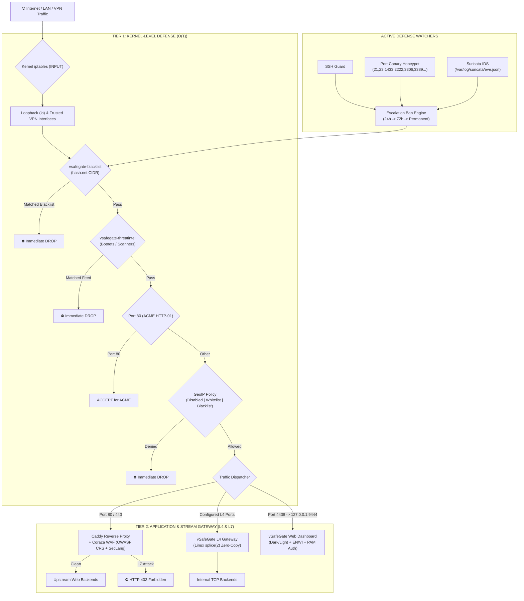

# 🛡️ vSafeGate — Open-Source Web Application Firewall (WAF) & L4 Stream Gateway

> **Language / Ngôn ngữ:** 🇬🇧 **English** ([README.en.md](README.en.md)) | 🇻🇳 [Tiếng Việt](README.md)

> **Multi-Server Linux Security Gateway & WAF**  
> Lightweight single-binary Go firewall solution combining **2-Tier Defense** (Linux Kernel `iptables`/`ipset` + Coraza WAF / Zero-Copy `splice(2)` L4 Proxy), an enterprise **Dark/Light Theme** dashboard, **Bilingual UI (English / Vietnamese)**, and **100% embedded local assets** (zero CDN dependencies).

---

## 🚀 KEY FEATURES

- **2-Tier Deep Defense Architecture:**
  - **Tier 1 (Kernel Level — O(1)):** Packet-level filtering via `iptables` and `ipset` (`vsafegate-blacklist`, `vsafegate-threatintel`, `vsafegate-allowed`, `vsafegate-countries`).
  - **Tier 2 (Application Level — L7 WAF):** **Caddy + Coraza WAF** powered by **OWASP Core Rule Set (CRS)** and customizable SecLang rules (`/etc/caddy/rules/custom-rules.conf`).
- **Multi-Server Generalization (Zero Hardcoding):**
  - **Tri-State GeoIP Policy (`disabled` | `whitelist` | `blacklist`):** Defaults to `disabled` on fresh installations so international VPS administrators are never locked out; switchable to `whitelist` or `blacklist` anytime.
  - **Auto-Detect Network Interfaces:** Scans physical LAN, Tailscale, WireGuard, ZeroTier, Docker/Bridge subnets and suggests CIDRs to whitelist in one click.
  - **SSH Anti-Lockout Fail-Safe:** `install.sh` automatically detects the active SSH session IP (`$SSH_CLIENT` / `$SSH_CONNECTION`) and pre-populates `whitelist_ips`.
- **High-Performance L4 Stream Gateway (Zero-Copy Linux `splice`):**
  - Forwards raw TCP streams directly in kernel space via `splice(2)` for low-latency services such as SMB (`445`), SSH, RDP, databases, or internal portals.
- **Modern Enterprise Web Dashboard:**
  - **Dark / Light Theme:** Instant toggle in the top header with automatic Chart.js grid/legend synchronization and `localStorage` persistence.
  - **Multi-Language (i18n EN / VI):** Real-time English and Vietnamese switching via embedded `mgt/web/i18n.js`.
  - **Zero-CDN Embedded UI:** Tailwind CSS, Chart.js, Lucide Icons, and translation dictionaries are compiled directly into the Go binary (`//go:embed web/*`).
- **Active Defense Watchers & Escalation Ban Policy:**
  - **SSH Guard:** Monitors failed SSH login attempts (default threshold: 3 attempts -> auto-ban).
  - **Port Canary Honeypot:** Listens on decoy ports (`21, 23, 1433, 2222, 3306, 3389, 5060, 5432, 6379, 8088`) and automatically bans port scanners.
  - **Suricata IDS Integration:** Tails `/var/log/suricata/eve.json` and auto-bans Severity 1 alerts when enabled.
  - **Escalation Ban Policy:** 1st offense bans for **24h** (`default_ban_ttl_hours`), 2nd offense bans for **72h**, 3rd+ offense bans **Permanently**.
- **Persistent Security Logs (JSONL):** Stored at `/var/log/vsafegate/attacks.jsonl` with automatic 20MB log rotation.

---

## 📦 INSTALLATION & SCRIPT USAGE (STEP-BY-STEP)

### System Requirements
- **Linux OS:** Debian, Ubuntu, Proxmox VE (`systemd`), Alpine Linux (`OpenRC`), RHEL/CentOS/Rocky/AlmaLinux (`systemd`), or Arch Linux.
- **CPU Architecture:** `x86_64` (`amd64`) or `aarch64` (`arm64`).
- **Privileges:** `root` or `sudo`.
- **System Dependencies (auto-installed by `install.sh`):** `curl`, `ipset`, `iptables`, `ca-certificates`, `tar`, `python3` (+ `bash` on Alpine).
- **Caddy + Coraza WAF (Optional for L7 WAF & HTTPS `:4438`):** The `vsafegate` management daemon binds locally on `127.0.0.1:9444`. To expose HTTPS `:4438` and L7 WAF sites on `:80`/`:443`, install Caddy built with `coraza-caddy/v2` (see **Step 3** below).

---

### Method 1: Quick One-Line Install Script from GitHub (Recommended)

**Step 1:** SSH into your Linux server as `root` or a `sudo`-capable user.

**Step 2:** Run the universal installer script:
```bash
curl -fsSL https://raw.githubusercontent.com/daovantrong/vSafeGate/main/install.sh | sudo bash
```

**What `install.sh` performs automatically:**
1. Validates root privileges and detects CPU architecture (`amd64` / `arm64`), OS distribution (`debian` / `alpine` / `rhel` / `arch`), and init system (`systemd` / `openrc`).
2. Installs required packages (`curl`, `ipset`, `iptables`, `ca-certificates`, `tar`, `python3`).
3. **Anti-Lockout Protection:** Extracts your current SSH client IP (`$SSH_CLIENT` / `$SSH_CONNECTION`) and adds it to `whitelist_ips`.
4. Downloads the latest release binary from [GitHub Releases](https://github.com/daovantrong/vSafeGate/releases) into `/usr/local/bin/vsafegate` (or falls back to a local binary / source compilation via `go` if no release tag exists yet).
5. Generates a safe default `/etc/vsafegate/config.json` with `"geoip_mode": "disabled"`.
6. Registers and starts the system service (`vsafegate.service` under `systemd`, or `/etc/init.d/vsafegate` under `OpenRC`) and links `/usr/bin/vsafegate`.

---

### Method 2: Clone GitHub Repository, Build & Run Script Locally

Recommended if you want to build from source (**Go 1.22+** required) or customize the codebase before installing:

```bash
# Step 1: Clone the repository
git clone https://github.com/daovantrong/vSafeGate.git
cd vSafeGate

# Step 2: Run unit tests and compile the Go binary for your server architecture
cd mgt
go test -v ./...
CGO_ENABLED=0 go build -ldflags="-s -w" -o ../vsafegate-linux-$(uname -m | sed 's/x86_64/amd64/;s/aarch64/arm64/') .
cd ..

# Step 3: Make the installer executable and run it
chmod +x install.sh
sudo bash install.sh
```

> **Cross-compiling from Windows / macOS to Linux:**
> ```powershell
> cd mgt
> $env:CGO_ENABLED="0"; $env:GOOS="linux"; $env:GOARCH="amd64"
> go build -ldflags="-s -w" -o ../vsafegate-linux-amd64 .
> ```
> Then copy `vsafegate-linux-amd64` and `install.sh` to your Linux host and execute `sudo bash install.sh`.

---

### Step 3: Installing Caddy + Coraza WAF (For L7 WAF & HTTPS `:4438`)

`vsafegate` manages `/etc/caddy/Caddyfile` and `/etc/caddy/rules/custom-rules.conf` automatically and triggers Caddy reloads on rule changes. Choose either option:

- **Option A — Native Caddy binary compiled with `xcaddy` (recommended for bare-metal / VM hosts):**
  ```bash
  go install github.com/caddyserver/xcaddy/cmd/xcaddy@latest
  xcaddy build --with github.com/corazawaf/coraza-caddy/v2 --output /usr/bin/caddy
  chmod +x /usr/bin/caddy
  ```
- **Option B — Docker Compose stack included in the repository:**
  ```bash
  docker compose up -d --build
  ```

> **If Caddy is not installed yet:** `vsafegate` still runs standalone on `127.0.0.1:9444` (managing iptables/ipset, L4 Proxy, SSH Guard, and Canary). You can securely open the Web Dashboard via an SSH tunnel:
> ```bash
> ssh -L 9444:127.0.0.1:9444 <user>@<SERVER_IP>
> # Open in your local browser: http://127.0.0.1:9444/
> ```

---

### Step 4: Accessing & Configuring the Web Dashboard

1. Open your browser at:
   - Via Caddy HTTPS proxy: `https://<SERVER_IP>:4438/` (accept the internal self-signed TLS cert on initial access)
   - Or via SSH tunnel: `http://127.0.0.1:9444/`
2. Sign in using your **Linux system account** (PAM / `/etc/shadow`) or configure `admin_user` / `admin_password` in `/etc/vsafegate/config.json`.
3. Use the top-right header toggles:
   - Click **`🇻🇳 VI` / `🇬🇧 EN`** to switch between English and Vietnamese.
   - Click **☀️ / 🌙** to toggle **Light / Dark Theme**.
4. Navigate to **Defense Rules** or **IP Management**:
   - Click **Interface Presets (`Rule Mẫu Card Mạng`)** to auto-detect and allow your server's LAN/VPN interfaces.
   - Optionally enable GeoIP **`Whitelist`** or **`Blacklist`** mode for country-level kernel filtering.
5. Add protected domains in **Sites & Proxy** or TCP forwarding ports in **L4 Services**.

---

### Method 3: Running in Development Mode (`ENV=dev`)

To preview UI changes and test APIs locally on Windows, macOS, or Linux:

```bash
cd mgt
ENV=dev go run .
```
- Uses local files (`./config.json`, `./Caddyfile`, `./rules/custom-rules.conf`, `./attacks.jsonl`).
- Enables the development login fallback `admin` / `vsafegate123` (only active when `ENV=dev`).

---

## 📐 SYSTEM ARCHITECTURE



---

## 🤖 AUTOMATED GITHUB RELEASES (CI/CD)

This repository includes [`.github/workflows/release.yml`](.github/workflows/release.yml). Pushing a version tag (e.g., `v2.1.0`) automatically:
1. Executes all Go unit tests (`cd mgt && go test -v ./...`).
2. Cross-compiles static binaries (`CGO_ENABLED=0`) for **`linux/amd64`** and **`linux/arm64`**.
3. Generates `sha256sums.txt`.
4. Publishes a **GitHub Release** with `vsafegate-linux-amd64`, `vsafegate-linux-arm64`, `sha256sums.txt`, and `install.sh`, enabling immediate one-line installs via `install.sh`.

```bash
git tag v2.1.0
git push origin v2.1.0
```

---

## 📁 PROJECT STRUCTURE

```text
vSafeGate/
├── .github/workflows/
│   └── release.yml             # CI/CD workflow for multi-arch tests, builds, and GitHub Releases
├── install.sh                  # Universal one-line installer (systemd & OpenRC)
├── README.md                   # Vietnamese documentation
├── README.en.md                # English documentation
├── SERVERS.md                  # Server inventory & port mapping template
├── Dockerfile                  # Builds Caddy 2.8 with Coraza WAF plugin
├── docker-compose.yml          # Container deployment for Caddy + Coraza
├── Caddyfile                   # Starter Caddyfile for Docker deployment
├── rules/
│   └── custom-rules.conf       # Custom Coraza SecLang WAF rules
└── mgt/                        # Go source code for vSafeGate Management Daemon
    ├── main.go                 # HTTP API, safe defaults & embedded web UI server
    ├── models.go               # Data models for Config, AttackLog, L4/L7 services, Presets
    ├── auth.go                 # Linux PAM/Shadow helper & PBKDF-SHA256 authentication
    ├── blacklist.go            # Blacklist management, TTL countdown & Escalation Ban
    ├── caddy.go                # Caddyfile & SecLang generator with debounced hot-reload
    ├── firewall.go             # iptables & ipset sync (Disabled / Whitelist / Blacklist)
    ├── l4proxy.go              # Zero-Copy Linux splice(2) L4 TCP Gateway
    ├── log_manager.go          # Persistent attacks.jsonl logger with 20MB rotation
    ├── network_detector.go     # Host LAN / VPN interface auto-detection
    ├── watchers.go             # SSH Guard, Port Canary Honeypot & Suricata EVE watcher
    ├── *_test.go               # Unit tests (deadlock safety, blacklist, logs, detector)
    └── web/                    # Embedded dashboard assets (zero-CDN)
        ├── index.html          # Responsive Web UI (Dark / Light Theme)
        ├── i18n.js             # Bilingual translation dictionary & engine (EN / VI)
        ├── tailwind.min.css    # Precompiled Tailwind CSS
        ├── chart.min.js        # Local Chart.js
        └── lucide.min.js       # Local Lucide Icons
```

---

## 🛠️ OPERATIONS & VERIFICATION COMMANDS

### 1. Service Management
- **Debian / Ubuntu / Proxmox / RHEL / Arch (`systemd`):**
  ```bash
  sudo systemctl status vsafegate
  sudo systemctl restart vsafegate
  sudo journalctl -u vsafegate -f
  ```
- **Alpine Linux (`OpenRC`):**
  ```bash
  sudo rc-service vsafegate status
  sudo rc-service vsafegate restart
  ```

### 2. Inspect Kernel Firewall (`ipset` & `iptables`)
```bash
# View allowed and blacklisted IP/CIDR entries
sudo ipset list vsafegate-allowed | head -n 20
sudo ipset list vsafegate-blacklist

# Inspect iptables INPUT chain ordering
sudo iptables -L INPUT -n --line-numbers
```

### 3. Verify WAF & L4 Protection
```bash
# Test 1: Verify Coraza WAF blocks SQL Injection (expects HTTP 403 once Site & Caddy are configured)
curl -k -i -H "Host: app.example.com" "https://<GATEWAY_IP>/?id=1%20UNION%20SELECT%20null,null"

# Test 2: Verify WAF blocks security scanner User-Agent
curl -k -i -A "sqlmap/1.8" -H "Host: app.example.com" "https://<GATEWAY_IP>/"

# Test 3: Verify configured L4 Gateway port connectivity
nc -zv <GATEWAY_IP> <L4_PORT>
```
