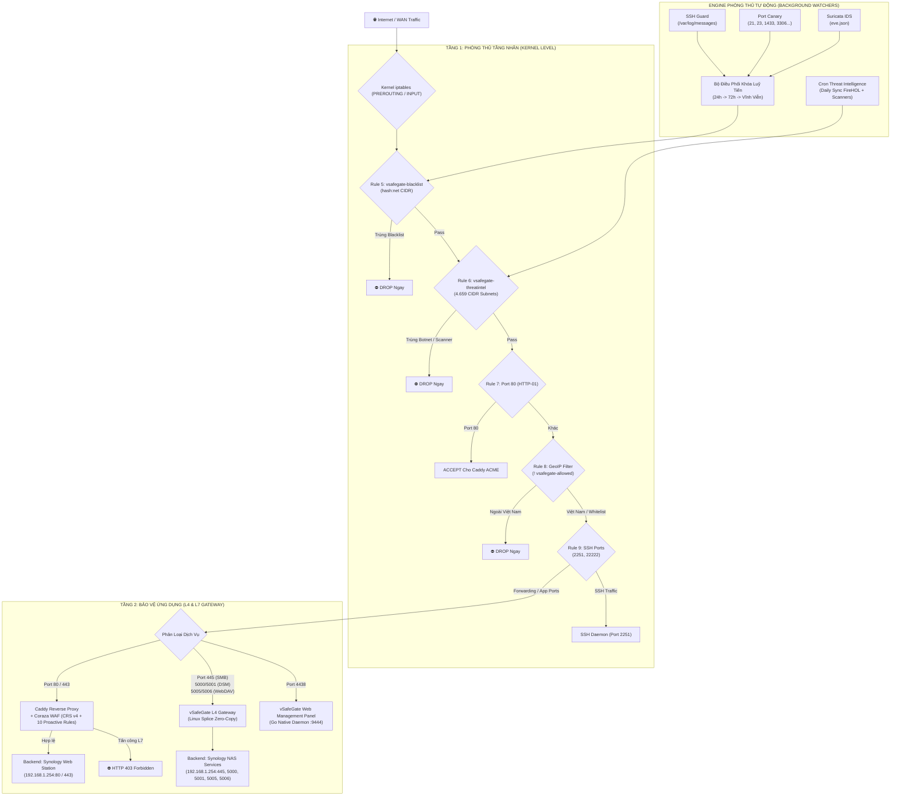

# 🛡️ vSafeGate — Hệ Thống Tường Lửa Web & L4 Gateway Toàn Diện

> **Open-Source Web Application Firewall (WAF) & L4 Stream Gateway**  
> Giải pháp thay thế hoàn hảo cho SafeLine WAF: Hiệu năng cao, bảo mật 2 tầng chuyên sâu, siêu nhẹ (**~150MB RAM** thay vì ngốn nhiều GB từ 7+ container Docker).

---

## 🚀 ĐIỂM NỔI BẬT

- **Bảo Vệ 2 Tầng Chuyên Sâu (2-Tier Defense):**
  - **Tầng 1 (Kernel Level - O(1)):** Chặn đứng botnet và kẻ tấn công ngay tại tầng nhân Linux bằng `iptables` kết hợp `ipset`. Tích hợp sẵn cơ chế **Kernel Threat Intelligence** tự động cập nhật hơn **4.600 dải mạng botnet/scanner toàn cầu** (FireHOL Level 1, Censys, Shodan, Shadowserver, BinaryEdge) và **Bộ lọc Địa lý GeoIP** (chỉ cho phép truy cập từ Việt Nam).
  - **Tầng 2 (Application Level - L7 WAF):** Bộ máy **Coraza WAF** (Caddy Core) tích hợp chuẩn công nghiệp **OWASP Core Rule Set (CRS v4)** kết hợp **10 Bộ quy tắc Chủ động (Proactive Rules)** ngăn chặn SQL Injection, XSS, Path Traversal, Web Shells, rò rỉ `.env`/`.git`, và các công cụ quét tự động (`sqlmap`, `nuclei`, `nikto`).
- **L4 Stream Gateway Hiệu Năng Cao (Zero-Copy Linux Splice):**
  - Chuyển tiếp luồng TCP cho các dịch vụ nặng như **Synology NAS SMB (Cổng 445)**, **DSM (5000/5001)**, **WebDAV (5005/5006)**.
  - Sử dụng trực tiếp Linux System Call `splice(2)` để chuyển tiếp dữ liệu trực tiếp trong Kernel pipe mà không qua User-space buffer, đạt tốc độ truyền tải tối đa và độ trễ cực thấp.
- **Tự Động Cấp Chứng Chỉ SSL/TLS:** Quản lý tự động cấp phát và gia hạn chứng chỉ qua Let's Encrypt / ZeroSSL (tích hợp sẵn qua Caddy Core).
- **Chính Sách Khóa IP Luỹ Tiến (Escalation Ban Policy):**
  - Vi phạm lần 1: Khóa **24 giờ**.
  - Vi phạm lần 2: Khóa **72 giờ (3 ngày)**.
  - Vi phạm lần 3 trở lên: Khóa **Vĩnh viễn**.
- **Cơ Chế Bẫy & Phòng Thủ Chủ Động (Active Defense):**
  - **SSH Guard:** Giám sát đăng nhập SSH, khóa tức thì sau 3 lần sai. Cổng SSH chính đổi sang **`2251`** (cổng 22 đóng hoàn toàn để loại bỏ bot quét ngẫu nhiên).
  - **Port Canary Honeypot:** Đặt cổng bẫy (`21`, `23`, `1433`, `3306`, `3389`, `6379`, `8088`), bắt và khóa ngay bất kỳ ai dò quét cổng.
  - **Suricata IDS Integration:** Tích hợp bộ phân tích gói tin mạng chuyên sâu Suricata EVE JSON.
- **Nhật Ký Tấn Công Bền Vững (Persistent JSONL):** Lưu trữ toàn bộ sự kiện tấn công vào `/var/log/vsafegate/attacks.jsonl` kèm cơ chế tự động xoay vòng an toàn (Log Rotation 20MB).

---

## 📐 KIẾN TRÚC HỆ THỐNG



---

## 📁 CẤU TRÚC THƯ MỤC DỰ ÁN

```text
d:\SafeLineWAF\
├── SERVERS.md                  # Sổ tay thông số máy chủ, địa chỉ IP, cổng SSH & chính sách kết nối
├── README.md                   # Tài liệu hướng dẫn kiến trúc, vận hành và cấu hình vSafeGate
├── rules/
│   └── custom-rules.conf       # Quy tắc WAF Coraza SecLang tùy biến
├── mgt/                        # Mã nguồn Go của vSafeGate Management Daemon
│   ├── main.go                 # HTTP API server & Bộ khởi tạo dịch vụ
│   ├── models.go               # Cấu trúc dữ liệu cấu hình, sự kiện tấn công, L4/L7 services
│   ├── blacklist.go            # Quản lý Blacklist, Hash:Net CIDR & Khóa IP luỹ tiến (Escalation Ban)
│   ├── log_manager.go          # Quản lý ghi file attacks.jsonl bền vững kèm Log Rotation (20MB)
│   ├── caddy.go                # Tự động sinh Caddyfile & nạp lại cấu hình mượt mà (Debounced Reload)
│   ├── auth.go                 # Xác thực người dùng qua PAM / Shadow an toàn
│   ├── l4proxy.go              # L4 TCP Gateway tối ưu hóa cao bằng Zero-Copy Linux Splice
│   ├── firewall.go             # Đồng bộ iptables 2 tầng và cấu hình GeoIP ipset
│   ├── watchers.go             # Trình giám sát SSH Guard, Port Canary và Suricata EVE log
│   └── web/                    # Dashboard giao diện Web tương tác (nhúng trực tiếp vào Go binary)
│       └── index.html          # Giao diện điều khiển WAF trực quan
└── scripts/                    # Scripts đồng bộ và kiểm tra hệ thống
```

---

## ⚙️ BẢNG DỊCH VỤ CẤU HÌNH (L4 & L7 GATEWAY)

| Dịch vụ | Tầng | Cổng nghe vSafeGate | Backend Đích | Giao thức / Cơ chế | Bảo vệ |
| :--- | :--- | :--- | :--- | :--- | :--- |
| **Web Station (HTTP)** | L7 | `:80` | `192.168.1.254:80` | Reverse Proxy | CRS v4 + 10 Proactive Rules |
| **Web Station (HTTPS)**| L7 | `:443` | `https://192.168.1.254:443` | Reverse Proxy + TLS | CRS v4 + 10 Proactive Rules |
| **Synology SMB** | L4 | `:445` | `192.168.1.254:445` | TCP Zero-Copy Splice | GeoIP VN + ThreatIntel + IPSet |
| **Synology DSM HTTP** | L4 | `:5000` | `192.168.1.254:5000` | TCP Zero-Copy Splice | GeoIP VN + ThreatIntel + IPSet |
| **Synology DSM HTTPS**| L4 | `:5001` | `192.168.1.254:5001` | TCP Zero-Copy Splice | GeoIP VN + ThreatIntel + IPSet |
| **Synology WebDAV HTTP**| L4 | `:5005` | `192.168.1.254:5005` | TCP Zero-Copy Splice | GeoIP VN + ThreatIntel + IPSet |
| **Synology WebDAV HTTPS**| L4 | `:5006` | `192.168.1.254:5006` | TCP Zero-Copy Splice | GeoIP VN + ThreatIntel + IPSet |
| **vSafeGate Dashboard** | L7 | `:4438` | `127.0.0.1:9444` | Web Panel HTTPS | PAM Auth + Whitelist Only |

---

## 🔒 10 QUY TẮC WAF CHỦ ĐỘNG (10 PROACTIVE CORAZA RULES)

Tất cả các quy tắc đã được biên dịch và kích hoạt trong `/etc/caddy/rules/custom-rules.conf`:

1. **Rule 1001 (Sensitive File Probe):** Chặn dò quét file nhạy cảm `.env`, `.git`, `.aws`, `.yml`, `.conf`, `id_rsa`.
2. **Rule 1002 (Web Shell / Backdoor):** Chặn truy cập web shells phổ biến (`shell.php`, `alfa.php`, `c99.php`, `wso.php`).
3. **Rule 1003 (Path Traversal / LFI):** Chặn kỹ thuật leo thang thư mục `../`, `..%2f`, `/etc/passwd`, `/etc/shadow`.
4. **Rule 1004 (SQL Injection Pattern):** Chặn chuỗi khai thác SQL (`UNION SELECT`, `SLEEP()`, `BENCHMARK()`, `OR 1=1`).
5. **Rule 1005 (XSS Script Injection):** Chặn script độc hại (`<script>`, `javascript:`, `onerror=`, `onload=`).
6. **Rule 1006 (Known Security Scanner UA):** Chặn công cụ quét lỗ hổng tự động (`sqlmap`, `nuclei`, `nikto`, `acunetix`, `nmap`).
7. **Rule 1007 (Suspicious Executable Extensions):** Chặn yêu cầu tải thực thi trái phép (`.bat`, `.sh`, `.exe`, `.cmd`).
8. **Rule 1008 (Admin & CMS Probe):** Chặn bot brute-force trang quản trị WordPress, Joomla, phpMyAdmin (`wp-login.php`, `xmlrpc.php`).
9. **Rule 1009 (Command Injection):** Chặn chuỗi tiêm mã lệnh hệ thống (`;cat /etc/`, `|whoami`, `` `id` ``, `$(id)`).
10. **Rule 1010 (Remote File Inclusion):** Chặn nạp file từ xa qua URL parameters (`http://`, `ftp://`, `php://input`).

---

## 🛠️ HƯỚNG DẪN QUẢN TRỊ & VẬN HÀNH

### 1. Truy cập SSH Quản Trị
```bash
# Truy cập vSafeGate VM (Alpine Linux):
ssh -p 2251 trong@100.101.102.1
# Hoặc qua mạng LAN nội bộ:
ssh -p 2251 trong@192.168.1.251
```

### 2. Quản lý Dịch vụ
- **Trên Alpine Linux (vSafeGate VM):**
  ```bash
  sudo rc-service vsafegate restart
  sudo rc-service caddy restart
  ```
- **Trên Debian / Proxmox VE:**
  ```bash
  sudo systemctl restart vsafegate
  sudo systemctl restart caddy
  ```

### 3. Đồng bộ Dữ liệu Tình báo Đe dọa (Threat Intelligence)
Hệ thống tự động chạy cron hàng ngày vào lúc nửa đêm, hoặc có thể kích hoạt thủ công:
```bash
sudo /usr/local/bin/vsafegate-sync-threatintel.sh
```

### 4. Kiểm tra Tình trạng Tường Lửa & Danh sách Chặn
```bash
# Kiểm tra số lượng dải IP botnet đang chặn ở Tầng 1:
sudo ipset list vsafegate-threatintel | head -n 10

# Kiểm tra danh sách IP bị Blacklist do vi phạm:
sudo ipset list vsafegate-blacklist

# Kiểm tra thứ tự các rule iptables:
sudo iptables -L INPUT -n --line-numbers
```

### 5. Thử Nghiệm Kiểm Tra Phòng Thủ (Verification Commands)
```bash
# Test 1: Kiểm tra WAF chặn SQL Injection (Kỳ vọng HTTP 403 Forbidden):
curl -k -i -H "Host: data.kientrucht.com" "https://192.168.1.251/?id=1%20UNION%20SELECT%20null,null"

# Test 2: Kiểm tra WAF chặn Security Scanner UA:
curl -k -i -A "sqlmap/1.8" -H "Host: data.kientrucht.com" "https://192.168.1.251/"

# Test 3: Kiểm tra L4 Gateway SMB (Port 445):
nc -zv 192.168.1.251 445

# Test 4: Kiểm tra L4 Gateway DSM (Port 5001):
curl -k -i https://192.168.1.251:5001/
```
