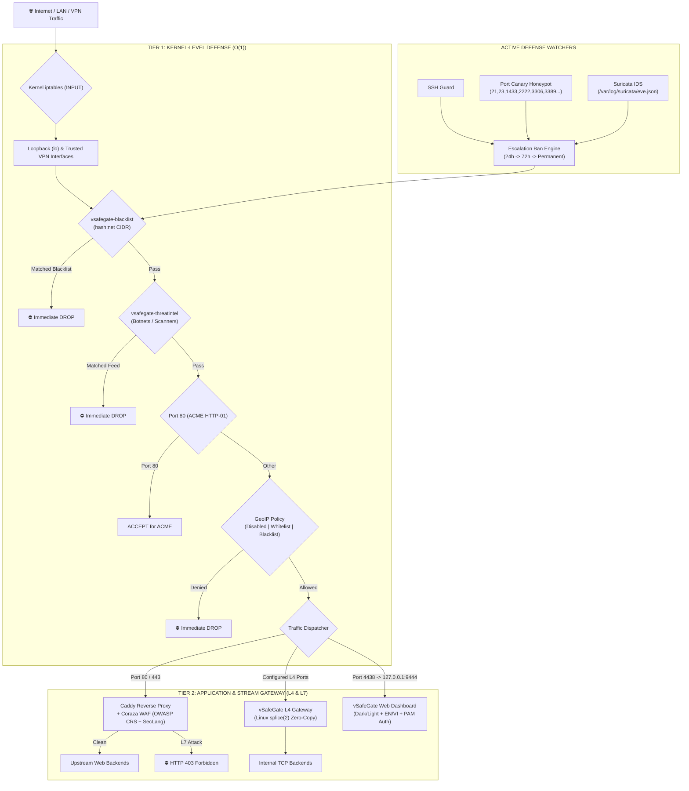

# 🛡️ vSafeGate — Open-Source Web Application Firewall (WAF) & L4 Stream Gateway

> **Language / Ngôn ngữ:** 🇬🇧 **English** ([README.md](README.md)) | 🇻🇳 [Tiếng Việt](README.vi.md)

> **Multi-Server Linux Security Gateway & WAF**  
> Lightweight single-binary Go firewall solution combining **2-Tier Defense** (Linux Kernel `iptables`/`ipset` + Coraza WAF / Zero-Copy `splice(2)` L4 Proxy), an enterprise **Dark/Light Theme** dashboard, **Bilingual UI (English / Vietnamese)**, and **100% embedded local assets** (zero CDN dependencies).

---

## 🚀 KEY FEATURES

- **2-Tier Deep Defense Architecture:**
  - **Tier 1 (Kernel Level — O(1)):** Packet-level filtering via `iptables` and `ipset` (`vsafegate-blacklist`, `vsafegate-threatintel`, `vsafegate-allowed`, `vsafegate-countries`).
  - **Tier 2 (Application Level — L7 WAF):** **Caddy + Coraza WAF** powered by **OWASP Core Rule Set (CRS)** and customizable SecLang rules (`/etc/caddy/rules/custom-rules.conf`).
- **Multi-Server Generalization (Zero Hardcoding):**
  - **Tri-State GeoIP Policy (`disabled` | `whitelist` | `blacklist`):** Defaults to `disabled` on fresh installations so international VPS administrators are never locked out; switchable to `whitelist` or `blacklist` anytime.
  - **Auto-Detect Network Interfaces:** Scans physical LAN, Tailscale, WireGuard, ZeroTier, Docker/Bridge subnets and suggests CIDRs to whitelist in one click.
  - **SSH Anti-Lockout Fail-Safe:** `install.sh` automatically detects the active SSH session IP (`$SSH_CLIENT` / `$SSH_CONNECTION`) and pre-populates `whitelist_ips`.
- **High-Performance L4 Stream Gateway (Zero-Copy Linux `splice`):**
  - Forwards raw TCP streams directly in kernel space via `splice(2)` for low-latency services such as SMB (`445`), SSH, RDP, databases, or internal portals.
- **Modern Enterprise Web Dashboard:**
  - **Dark / Light Theme:** Instant toggle in the top header with automatic Chart.js grid/legend synchronization and `localStorage` persistence.
  - **Multi-Language (i18n EN / VI):** Real-time English and Vietnamese switching via embedded `mgt/web/i18n.js`.
  - **Zero-CDN Embedded UI:** Tailwind CSS, Chart.js, Lucide Icons, and translation dictionaries are compiled directly into the Go binary (`//go:embed web/*`).
- **Active Defense Watchers & Escalation Ban Policy:**
  - **SSH Guard:** Monitors failed SSH login attempts (default threshold: 3 attempts -> auto-ban).
  - **Port Canary Honeypot:** Listens on decoy ports (`21, 23, 1433, 2222, 3306, 3389, 5060, 5432, 6379, 8088`) and automatically bans port scanners.
  - **Suricata IDS Integration:** Tails `/var/log/suricata/eve.json` and auto-bans Severity 1 alerts when enabled.
  - **Escalation Ban Policy:** 1st offense bans for **24h** (`default_ban_ttl_hours`), 2nd offense bans for **72h**, 3rd+ offense bans **Permanently**.
- **Persistent Security Logs (JSONL):** Stored at `/var/log/vsafegate/attacks.jsonl` with automatic 20MB log rotation.

---

## 📦 ONE-COMMAND AUTOMATED INSTALLATION

### System Requirements
- **Linux OS:** Debian, Ubuntu, Proxmox VE (`systemd`), Alpine Linux (`OpenRC`), RHEL/CentOS/Rocky/AlmaLinux (`systemd`), or Arch Linux.
- **CPU Architecture:** `x86_64` (`amd64`) or `aarch64` (`arm64`).
- **Privileges:** `root` or `sudo`.

---

### Full Stack Automated Setup (Zero Manual Steps)

SSH into your server and run a single command — **`install.sh` handles everything automatically without requiring you to manually download Go, Caddy, or configure services**:

```bash
curl -fsSL https://raw.githubusercontent.com/daovantrong/vSafeGate/main/install.sh | sudo bash
```

**What `install.sh` performs automatically from start to finish:**
1. **System Detection:** Detects CPU architecture (`amd64` / `arm64`), Linux distribution (`debian`, `alpine`, `rhel`, `arch`), and init system (`systemd` / `OpenRC`).
2. **System Packages:** Installs `iptables`, `ipset`, `curl`, `git`, `python3`, `ca-certificates`, `tar`, and `gzip`.
3. **SSH Anti-Lockout Fail-Safe:** Reads your active SSH session IP (`$SSH_CLIENT` / `$SSH_CONNECTION`) and automatically adds it to `whitelist_ips`.
4. **Installs `vsafegate` Core Daemon:** Downloads the prebuilt binary from [GitHub Releases](https://github.com/daovantrong/vSafeGate/releases); if no release exists yet, **automatically installs a temporary Go toolchain, clones the repo, builds `/usr/local/bin/vsafegate`, and cleans up temporary build files**.
5. **Installs `Caddy + Coraza WAF`:** Downloads the prebuilt Caddy binary compiled with `coraza-caddy/v2` (or **automatically builds it via `xcaddy`**) to `/usr/bin/caddy`, enabling L7 WAF (`:80`/`:443`) and HTTPS Admin Proxy (`:4438`) immediately.
6. **Multi-Server Safe Configuration:** Generates `/etc/vsafegate/config.json` with `"geoip_mode": "disabled"` so international administrators are never locked out.
7. **Automated Threat Intelligence Sync:** Installs `/usr/local/bin/vsafegate-sync-threatintel.sh`, adds a daily cron job, and runs the initial `vsafegate-threatintel` sync.
8. **Registers & Starts Services:** Creates and enables both `vsafegate` and `caddy` services (`systemd` / `OpenRC`), plus installs `sudo vsafegate-update` for one-command upgrades.

---

### First-Time Web Dashboard Access

1. Open the URL printed at the end of the installer:
   - **`https://<SERVER_IP>:4438/`** *(accept the internal self-signed TLS certificate on first visit)*
2. Sign in with your server's **Linux PAM account** (`sudo` user).
3. In the top-right header bar:
   - Click **`🇻🇳 VI` / `🇬🇧 EN`** to switch between English and Vietnamese.
   - Click **☀️ / 🌙** to toggle **Light / Dark Theme**.
4. Go to **Defense Rules** → click **Interface Presets (`Rule Mẫu Card Mạng`)** to auto-detect and allow your host's LAN/VPN interfaces, and configure GeoIP or L4/L7 services as needed.

### One-Command Upgrade
```bash
sudo vsafegate-update
```
*(Automatically downloads/builds the latest version and restarts `vsafegate` & `caddy` while **preserving** `/etc/vsafegate/config.json`)*

---

### Advanced / Developer Options

<details>
<summary>Expand for local repo install, Development Mode (ENV=dev), or Docker Compose</summary>

#### A. Run installer from a cloned repository
```bash
git clone https://github.com/daovantrong/vSafeGate.git
cd vSafeGate
sudo bash install.sh
```

#### B. Run locally in Development Mode
```bash
cd mgt
ENV=dev go run .
```
- Uses local files (`./config.json`, `./Caddyfile`, `./rules/custom-rules.conf`, `./attacks.jsonl`).
- Enables the development login fallback `admin` / `vsafegate123` (active only when `ENV=dev`).

#### C. Run Caddy + Coraza standalone via Docker Compose
```bash
docker compose up -d --build
```

</details>

---

## 📐 SYSTEM ARCHITECTURE



---

## 🤖 AUTOMATED GITHUB RELEASES (CI/CD — SELF-CONTAINED)

This repository vendors all Caddy + Coraza WAF + OWASP CRS dependencies inside [`caddy-core/`](caddy-core/) (`Caddy v2.11.9`, `coraza-caddy/v2 v2.6.2`, `coraza-coreruleset/v4 v4.25.0`, built with `Go 1.27.1`) and keeps zero external dependencies in [`mgt/`](mgt/). Builds never break even if upstream packages change.

Pushing the release tag (e.g., `v1.0.1`) automatically triggers [`.github/workflows/release.yml`](.github/workflows/release.yml) to:
1. Execute all Go unit tests (`cd mgt && go test -v ./...`).
2. Cross-compile reproducible static binaries (`CGO_ENABLED=0`, `-mod=vendor`) for **`linux/amd64`** and **`linux/arm64`**, for both **`vsafegate`** and **`caddy-coraza`**.
3. Generate `sha256sums.txt`.
4. Publish a **GitHub Release** with `vsafegate-linux-amd64`, `vsafegate-linux-arm64`, `caddy-coraza-linux-amd64`, `caddy-coraza-linux-arm64`, `sha256sums.txt`, `VERSION`, and `install.sh`.

```bash
git tag v1.0.1
git push origin v1.0.1
```

---

## 📁 PROJECT STRUCTURE

```text
vSafeGate/
├── .github/workflows/
│   └── release.yml             # CI/CD workflow (Go 1.27.1, vendored offline builds, GitHub Releases)
├── VERSION                     # Canonical release version (1.0.1)
├── install.sh                  # All-in-one automated installer (systemd & OpenRC, zero external lock-in)
├── README.md                   # English documentation (Primary)
├── README.vi.md                # Vietnamese documentation
├── SERVERS.md                  # Server inventory & port mapping template
├── Dockerfile                  # Offline vendored Docker build (golang:1.27.1-alpine -> alpine:3.21)
├── docker-compose.yml          # Container deployment for Caddy + Coraza
├── Caddyfile                   # Starter Caddyfile for Docker deployment
├── rules/
│   └── custom-rules.conf       # Custom Coraza SecLang WAF rules
├── scripts/
│   └── vsafegate-sync-threatintel.sh  # Kernel Threat Intelligence ipset updater
├── caddy-core/                 # Self-contained vendored Caddy + Coraza WAF + OWASP CRS source
│   ├── main.go                 # Caddy entrypoint registering standard + Coraza WAF modules
│   ├── go.mod / go.sum         # Pinned Go 1.27.1, Caddy v2.11.9, Coraza-Caddy v2.6.2
│   └── vendor/                 # Full vendored Go module tree (offline reproducible builds)
└── mgt/                        # Go source code for vSafeGate Management Daemon (stdlib only)
    ├── main.go                 # HTTP API, safe defaults & embedded web UI server
    ├── models.go               # Data models for Config, AttackLog, L4/L7 services, Presets
    ├── auth.go                 # Linux PAM/Shadow helper & PBKDF-SHA256 authentication
    ├── blacklist.go            # Blacklist management, TTL countdown & Escalation Ban
    ├── caddy.go                # Caddyfile & SecLang generator with debounced hot-reload
    ├── firewall.go             # iptables & ipset sync (Disabled / Whitelist / Blacklist)
    ├── l4proxy.go              # Zero-Copy Linux splice(2) L4 TCP Gateway
    ├── log_manager.go          # Persistent attacks.jsonl logger with 20MB rotation
    ├── network_detector.go     # Host LAN / VPN interface auto-detection
    ├── watchers.go             # SSH Guard, Port Canary Honeypot & Suricata EVE watcher
    ├── *_test.go               # Unit tests (deadlock safety, blacklist, logs, detector)
    └── web/                    # Embedded dashboard assets (zero-CDN)
        ├── index.html          # Responsive Web UI (Dark / Light Theme)
        ├── i18n.js             # Bilingual translation dictionary & engine (EN / VI)
        ├── tailwind.min.css    # Precompiled Tailwind CSS
        ├── chart.min.js        # Local Chart.js
        └── lucide.min.js       # Local Lucide Icons
```

---

## 🛠️ OPERATIONS & VERIFICATION COMMANDS

### 1. Service Management
- **Debian / Ubuntu / Proxmox / RHEL / Arch (`systemd`):**
  ```bash
  sudo systemctl status vsafegate caddy
  sudo systemctl restart vsafegate caddy
  sudo journalctl -u vsafegate -f
  ```
- **Alpine Linux (`OpenRC`):**
  ```bash
  sudo rc-service vsafegate status && sudo rc-service caddy status
  sudo rc-service vsafegate restart && sudo rc-service caddy restart
  ```

### 2. Inspect Kernel Firewall (`ipset` & `iptables`)
```bash
# View allowed and blacklisted IP/CIDR entries
sudo ipset list vsafegate-allowed | head -n 20
sudo ipset list vsafegate-blacklist

# Inspect iptables INPUT chain ordering
sudo iptables -L INPUT -n --line-numbers
```

### 3. Verify WAF & L4 Protection
```bash
# Test 1: Verify Coraza WAF blocks SQL Injection (expects HTTP 403 once Site & Caddy are configured)
curl -k -i -H "Host: app.example.com" "https://<GATEWAY_IP>/?id=1%20UNION%20SELECT%20null,null"

# Test 2: Verify WAF blocks security scanner User-Agent
curl -k -i -A "sqlmap/1.8" -H "Host: app.example.com" "https://<GATEWAY_IP>/"

# Test 3: Verify configured L4 Gateway port connectivity
nc -zv <GATEWAY_IP> <L4_PORT>
```
