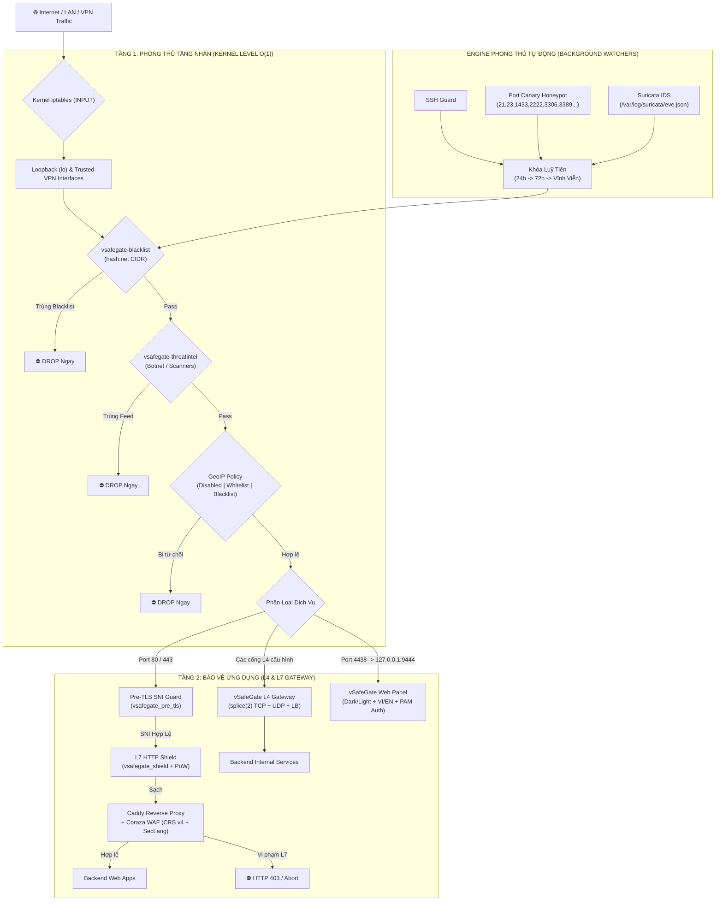

# 🛡️ vSafeGate — Hệ Thống Tường Lửa Web (WAF) & L4 Stream Gateway

> **Ngôn ngữ / Language:** 🇻🇳 **Tiếng Việt** ([README.vi.md](README.vi.md)) | 🇬🇧 [English](README.md)

> **Open-Source Web Application Firewall (WAF) & L4 Stream Gateway**  
> Giải pháp tường lửa đa máy chủ viết bằng Go: Bảo vệ 2 tầng (Linux Kernel `iptables`/`ipset` + Coraza WAF / L4 Zero-Copy `splice(2)`), giao diện Web **Dark/Light Theme**, **Đa ngôn ngữ (Tiếng Việt / English)** và nhúng hoàn toàn tài nguyên trong **1 file binary duy nhất** (0 CDN, 0 Docker bắt buộc).

---

## 🚀 ĐIỂM NỔI BẬT

- **Bảo Vệ 2 Tầng Chuyên Sâu (2-Tier Dual-Stack Defense):**
  - **Tầng 1 (Kernel Level - O(1)):** Lọc kết nối ngay tại nhân Linux qua `VSAFEGATE_INPUT` / `VSAFEGATE6_INPUT` (`iptables` + `ipset`: `vsafegate-blacklist`, `vsafegate-threatintel`, `vsafegate-allowed`, `vsafegate-countries`, `vsafegate-trusted`), chặn toàn bộ IPv6 ngoài link-local (`::1` & `fe80::/10`), giới hạn SYN/UDP/ICMP `hashlimit`/`connlimit`, và tùy chọn lọc Egress (`VSAFEGATE_OUTPUT`).
  - **Tầng 2 (Application Level - Ẩn Định Danh Pre-TLS, L7 Shield & Coraza WAF):** **Caddy + Coraza WAF** biên dịch nội bộ cấu hình qua **Caddy JSON** (`/etc/caddy/caddy.json`), module Pre-TLS (`vsafegate_pre_tls`) ngắt im lặng kết nối quét IP/SNI lạ trước handshake (0 lộ chứng chỉ), **`vsafegate_shield`** chống HTTP Flood & Anti-Bot (rate/concurrency limit, chấm điểm hành vi & JA4-light, JS PoW Challenge HMAC-SHA256 không trạng thái, bypass search bot xác thực), chuẩn **OWASP CRS v4** tinh chỉnh theo từng site + miễn trừ 1-click và quy tắc SecLang (`/etc/caddy/rules/custom-rules.conf`).
- **Cloudflare DNS-01, Auto-Orange-Cloud Failover & Panel SSL 3 Tab:**
  - Tích hợp sẵn module offline `dns.providers.cloudflare` cấp SSL ACME DNS-01 (hỗ trợ Wildcard `*.domain.com`), trình quản lý bản ghi DNS Cloudflare, tự đồng bộ `trusted_proxies` chống tự khóa (anti-self-DoS), **Auto-Proxy failover** (tự bật mây cam `proxied: true` khi gặp lưu lượng bất thường), và upload cặp `.crt`/`.key` (tương thích cả Cloudflare Origin CA).
  - Khối **Panel SSL 3 Tab** (`Let's Encrypt DNS-01/HTTP-01` | `Custom SSL` | `Tự ký`) với cơ chế tự động fallback sang Tự ký khi ACME lỗi và tùy chọn mở/cô lập cổng quản trị (`mgmt_allow_public_internet`, `mgmt_listen_ips`, `mgmt_allowed_cidrs`).
- **Kiến Trúc Đa Máy Chủ & Setup Wizard (Zero Hardcode):**
  - **GeoIP 3 Chế Độ (`disabled` | `whitelist` | `blacklist`):** Mặc định `disabled` khi cài mới để tránh tự khóa quản trị viên trên VPS quốc tế.
  - **Cấu Hình Động `TrustedInterfaces` & `SSHPorts`:** Khai báo card mạng VPN/LAN tin cậy (`tailscale+`, `zt+`, `wg0`, `tun+`) và cổng SSH trực tiếp trên giao diện hoặc qua **Setup Wizard lần đầu**.
  - **Tự Động Phát Hiện Card Mạng & Anti-Lockout Fail-Safe:** Tự quét LAN/VPN và tự nạp IP SSH hiện tại vào `whitelist_ips` khi cài đặt.
- **L4 Stream Gateway Hiệu Năng Cao (Zero-Copy Linux `splice` & UDP):**
  - Chuyển tiếp TCP bằng `splice(2)` và UDP kèm Rate Limit theo IP, MaxConns, PROXY Protocol v1/v2, Load Balancing nhiều backend + health check.
- **SOC Telemetry, Cảnh Báo Đa Kênh & CLI Hợp Nhất:**
  - **Telemetry & Audit Log:** Thu thập `:2019/metrics` + kernel drop counters, stream tấn công SSE trực tiếp, lưu log phân vùng theo giờ có retention, Backup/Restore JSON và Admin Audit Log.
  - **Cảnh Báo Tức Thời (`AlertEngine`):** Gom cụm chống spam qua **Email SMTP** (STARTTLS/SSL), **Telegram Bot**, **Discord Webhook** và **Generic JSON Webhook** (ký HMAC-SHA256 `X-vSafeGate-Signature`).
  - **CLI Hợp Nhất:** Quản trị nhanh bằng `sudo vsafegate status|restart|logs|update|uninstall|version`.
- **Giao Diện Quản Trị Hiện Đại:**
  - **Dark / Light Theme**, **Đa Ngôn Ngữ (VI / EN)** qua `mgt/web/i18n.js`, và **100% Tài Nguyên Nhúng** (`//go:embed web/*`).
- **Phòng Thủ Chủ Động & Khóa Luỹ Tiến (Active Defense & Escalation Ban):**
  - **SSH Guard:** Giám sát nhật ký đăng nhập SSH sai (mặc định 3 lần -> auto-ban).
  - **Port Canary Honeypot:** Lắng nghe trên các cổng bẫy (`21, 23, 1433, 2222, 3306, 3389, 5060, 5432, 6379, 8088`) để bắt và khóa bot dò quét cổng.
  - **Suricata IDS Integration:** Theo dõi `/var/log/suricata/eve.json` và tự động chặn IP vi phạm mức nghiêm trọng 1.
  - **Chính sách khóa luỹ tiến:** Vi phạm lần 1 khóa **24h** (theo `default_ban_ttl_hours`), lần 2 khóa **72h**, lần 3+ khóa **Vĩnh viễn**.
- **Nhật Ký Tấn Công Bền Vững (Persistent JSONL):** Ghi vào `/var/log/vsafegate/attacks.jsonl` có xoay vòng tự động (Log Rotation 20MB).

---

## 📦 CÀI ĐẶT TỰ ĐỘNG HOÀN TOÀN (1 LỆNH DUY NHẤT)

### Yêu Cầu Hệ Thống
- **Hệ điều hành Linux:** Debian, Ubuntu, Proxmox VE VM & LXC container (`systemd`), Alpine Linux (`OpenRC`), RHEL/CentOS/Rocky/Alma (`systemd`), hoặc Arch Linux.
- **Kiến trúc CPU:** `x86_64` (`amd64`) hoặc `aarch64` (`arm64`).
- **Quyền thực thi:** `root` hoặc `sudo`.

---

### Cài Đặt Toàn Bộ Hệ Thống Trong 1 Lệnh

Chỉ cần SSH vào máy chủ và chạy duy nhất lệnh sau — **script sẽ tự động tải, biên dịch (nếu cần), cài đặt và khởi chạy toàn bộ từ A-Z mà không bắt bạn cài thủ công Go hay Caddy**:

```bash
curl -fsSL https://raw.githubusercontent.com/daovantrong/vSafeGate/main/install.sh | sudo bash
```

**Script `install.sh` tự động làm hết 100%:**
1. **Nhận diện hệ thống:** Tự phát hiện kiến trúc (`amd64` / `arm64`), distro Linux (`debian`, `alpine`, `rhel`, `arch`) và init system (`systemd` hoặc `OpenRC`).
2. **Cài đặt gói hệ thống:** Tự cài `iptables`, `ipset`, `curl`, `git`, `python3`, `ca-certificates`, `tar`, `gzip`.
3. **Chống tự khóa SSH (Anti-Lockout):** Tự đọc IP phiên SSH hiện tại (`$SSH_CLIENT` / `$SSH_CONNECTION`) và nạp sẵn vào `whitelist_ips`.
4. **Cài đặt Core `vsafegate`:** Tự tải binary từ [GitHub Releases](https://github.com/daovantrong/vSafeGate/releases); nếu chưa có bản phát hành, **tự động tải Go tạm thời, clone mã nguồn, biên dịch `/usr/local/bin/vsafegate` và xóa sạch file tạm**.
5. **Cài đặt `Caddy + Coraza WAF`:** Tự tải Caddy tích hợp sẵn `coraza-caddy/v2`, `vsafegate_pre_tls` và `dns.providers.cloudflare` (hoặc **tự động biên dịch offline từ `caddy-core/` qua `go build -mod=vendor`**) vào `/usr/bin/caddy`, tự kiểm tra chính xác version và danh sách module tùy biến mỗi khi cài đặt hoặc chạy `vsafegate-update`.
6. **Cấu hình an toàn đa server:** Tạo `/etc/vsafegate/config.json` (`0600`) với `"geoip_mode": "disabled"` (không tự khóa VPS ở nước ngoài) và cô lập cổng quản trị về `127.0.0.1:4438` (cùng `mgmt_listen_ips` nếu khai báo).
7. **Kích hoạt Threat Intelligence tự động:** Cài `/usr/local/bin/vsafegate-sync-threatintel.sh`, lập lịch cron hằng ngày và đồng bộ ngay bảng chặn `vsafegate-threatintel`.
8. **Đăng ký & Khởi chạy duy nhất 1 dịch vụ:** Chỉ tạo và bật **`vsafegate`** (`systemd` / `OpenRC`); tiến trình này tự động khởi chạy, giám sát, tự phục hồi và reload Caddy L7 WAF — kèm lệnh `sudo vsafegate-update` và `sudo vsafegate-uninstall`.

---

### Truy Cập & Cấu Hình Sau Khi Cài Đặt

1. Mở đường hầm SSH (`ssh -N -L 4438:127.0.0.1:4438 root@<SERVER_IP>`) và truy cập:
   - **`https://127.0.0.1:4438/`** *(chấp nhận chứng chỉ tự ký nội bộ ở lần đầu; sau đó có thể mở thêm IP LAN/VPN trong phần Cài Đặt -> Management Listen IPs)*
2. Đăng nhập bằng **tài khoản Linux (`sudo` user)** của máy chủ.
3. Trên góc phải thanh Header:
   - Nhấn **`🇻🇳 VI` / `🇬🇧 EN`** để chuyển ngôn ngữ.
   - Nhấn **☀️ / 🌙** để đổi **Light / Dark Theme**.
4. Vào **Quy Tắc Phòng Thủ (Defense Rules)** → nhấn **`Rule Mẫu Card Mạng`** để tự quét & cho phép các card mạng LAN/VPN (Tailscale, WireGuard, Ethernet...), sau đó cấu hình GeoIP hoặc dịch vụ L4/L7 theo nhu cầu.

### Lệnh CLI, Cập Nhật & Gỡ Cài Đặt Trong 1 Lệnh
```bash
# Quản trị dịch vụ qua CLI hợp nhất
sudo vsafegate status
sudo vsafegate restart
sudo vsafegate logs

# Cập nhật phiên bản mới (giữ nguyên cấu hình /etc/vsafegate/config.json)
sudo vsafegate update   # hoặc: sudo vsafegate-update

# Gỡ cài đặt & dọn dẹp sạch rule tường lửa (tự backup config vào /var/backups/vsafegate/)
sudo vsafegate uninstall   # hoặc: sudo vsafegate-uninstall
# Hoặc chạy gỡ trực tiếp từ GitHub (thêm --purge nếu muốn xóa luôn cả bản backup):
curl -fsSL https://raw.githubusercontent.com/daovantrong/vSafeGate/main/install.sh | sudo bash -s -- --uninstall
```

---

### Tùy Chọn Nâng Cao (Developer / Docker)

<details>
<summary>Mở rộng để xem cách chạy từ repo đã clone, chế độ Dev hoặc Docker Compose</summary>

#### A. Chạy script từ thư mục repo đã clone sẵn
```bash
git clone https://github.com/daovantrong/vSafeGate.git
cd vSafeGate
sudo bash install.sh
```

#### B. Chạy thử nghiệm giao diện cục bộ (Development Mode)
```bash
cd mgt
ENV=dev go run .
```
- Sử dụng dữ liệu cục bộ `./config.json`, `./Caddyfile`, `./rules/custom-rules.conf`, `./attacks.jsonl`.
- Tài khoản dev: `admin` / `vsafegate123` (chỉ hoạt động khi `ENV=dev`).

#### C. Chạy riêng Caddy + Coraza bằng Docker Compose
```bash
docker compose up -d --build
```

</details>

---

## 📐 KIẾN TRÚC HỆ THỐNG



---

## 🤖 PHÁT HÀNH TỰ ĐỘNG QUA GITHUB ACTIONS (CI/CD — KHÉP KÍN TRONG REPO)

Toàn bộ mã nguồn và phụ thuộc của Caddy + Coraza WAF + OWASP CRS đã được lưu (vendored) trọn vẹn trong [`caddy-core/`](caddy-core/) (`Caddy v2.11.9`, `coraza-caddy/v2 v2.6.2`, `coraza-coreruleset/v4 v4.25.0`, biên dịch bằng `Go 1.27.1`) và [`mgt/`](mgt/) không dùng bất kỳ thư viện Go ngoài nào — đảm bảo build không bao giờ bị gãy khi bên ngoài thay đổi.

Khi bạn đẩy tag phát hành (ví dụ `v1.0.1`), workflow [`.github/workflows/release.yml`](.github/workflows/release.yml) sẽ tự động:
1. Chạy toàn bộ unit test (`cd mgt && go test -v ./...`).
2. Biên dịch chéo binary tĩnh (`CGO_ENABLED=0`, `-mod=vendor`) cho **`linux/amd64`** và **`linux/arm64`**, gồm cả **`vsafegate`** và **`caddy-coraza`**.
3. Tạo file kiểm tra toàn vẹn `sha256sums.txt`.
4. Tạo **GitHub Release** mới đính kèm `vsafegate-linux-amd64`, `vsafegate-linux-arm64`, `caddy-coraza-linux-amd64`, `caddy-coraza-linux-arm64`, `sha256sums.txt`, `VERSION` và `install.sh`.

```bash
git tag v1.0.1
git push origin v1.0.1
```

---

## 📁 CẤU TRÚC THƯ MỤC DỰ ÁN

```text
vSafeGate/
├── .github/workflows/
│   └── release.yml             # CI/CD tự động test, build amd64/arm64 (Go 1.27.1, vendored) & Release
├── VERSION                     # Phiên bản phát hành chuẩn (1.0.1)
├── install.sh                  # Script cài đặt tự động hoàn toàn 1 dòng (Systemd & OpenRC)
├── README.md                   # Tài liệu hướng dẫn Tiếng Anh (Mặc định)
├── README.vi.md                # Tài liệu hướng dẫn Tiếng Việt
├── SERVERS.example.md          # Mẫu danh mục máy chủ & ánh xạ cổng (file SERVERS.md nội bộ được gitignore)
├── Dockerfile                  # Docker build offline từ caddy-core (golang:1.27.1-alpine -> alpine:3.21)
├── docker-compose.yml          # Triển khai Caddy + Coraza container
├── Caddyfile                   # Mẫu Caddyfile khởi tạo cho Docker
├── rules/
│   └── custom-rules.conf       # Quy tắc WAF Coraza SecLang tùy biến
├── scripts/
│   └── vsafegate-sync-threatintel.sh  # Script đồng bộ Threat Intelligence ipset
├── caddy-core/                 # Mã nguồn + toàn bộ dependency đã vendor của Caddy & Coraza WAF
│   ├── main.go                 # Entrypoint đăng ký Coraza WAF, Pre-TLS, Shield & CF DNS
│   ├── PATCHES.md              # Bản vá có kiểm soát (ẩn header Server, vá Coraza drop & AuditLogWriter)
│   ├── forks/                  # Bản fork đồng bộ qua sync_forks.sh & kiểm tra tự động bằng test
│   ├── modules/                # Module Caddy nội bộ (pre_tls/, shield/, cf_dns/)
│   ├── go.mod / go.sum         # Khóa cứng Go 1.27.1, Caddy v2.11.9, Coraza-Caddy v2.6.2
│   └── vendor/                 # Toàn bộ thư viện Go đi kèm (build offline 100% qua -mod=vendor)
└── mgt/                        # Mã nguồn Go của vSafeGate Management Daemon (chỉ dùng thư viện chuẩn)
    ├── main.go                 # HTTP API, CLI subcommands, CSRF/rate-limit & nhúng giao diện Web
    ├── models.go               # Cấu trúc dữ liệu Config, Site, WAFExclusion, L4/L7, Cloudflare & Alerts
    ├── alert.go                # AlertEngine đa kênh (Email SMTP, Telegram, Discord, Webhook)
    ├── audit.go                # Nhật ký thao tác quản trị Admin Audit Log (/api/audit)
    ├── auth.go                 # Xác thực PAM/Shadow (`/usr/local/bin/vsafegate-auth`) & PBKDF-SHA256
    ├── blacklist.go            # Quản lý Blacklist, TTL Auto-Unban & Khóa luỹ tiến chống tự khóa
    ├── caddy.go                # Sinh Caddy JSON, CRS v4 SecLang & quản lý Panel SSL (/load reload)
    ├── caddy_supervisor.go     # Giám sát và tự phục hồi tiến trình con Caddy
    ├── cloudflare.go           # Trình gọi Cloudflare API, Auto-Proxy failover & Upload Cert custom
    ├── firewall.go             # Đồng bộ iptables/ip6tables & ipset (VSAFEGATE_INPUT / VSAFEGATE6_INPUT)
    ├── l4proxy.go              # L4 TCP/UDP Gateway tối ưu hóa bằng Linux splice(2), LB & RateLimit
    ├── log_manager.go          # Quản lý nhật ký JSONL phân vùng theo giờ kèm chính sách lưu trữ
    ├── network_detector.go     # Tự động phát hiện card mạng LAN / VPN trên máy chủ
    ├── shield_events.go        # Tiếp nhận sự kiện L7 từ vsafegate_shield qua Unix socket
    ├── telemetry.go            # Thu thập số liệu thực tế Prometheus/Kernel & SSE stream
    ├── watchers.go             # SSH Guard, Port Canary Honeypot, Coraza JSON audit & Suricata EVE Watcher
    ├── *_test.go               # Bộ Unit Tests (Phase 0–4, chạy kèm -race)
    └── web/                    # Tài nguyên Web nhúng trực tiếp vào binary
        ├── index.html          # Giao diện Dashboard (Dark / Light Theme)
        ├── i18n.js             # Bộ từ điển & engine đa ngôn ngữ (VI / EN)
        ├── tailwind.min.css    # Tailwind CSS biên dịch sẵn (0 CDN)
        ├── chart.min.js        # Chart.js cục bộ
        └── lucide.min.js       # Lucide Icons cục bộ
```

---

## 🛠️ VẬN HÀNH & KIỂM TRA HỆ THỐNG

### 1. Quản Lý Dịch Vụ (Chỉ 1 Service Duy Nhất)
`vsafegate` trực tiếp khởi chạy, giám sát, tự khôi phục và reload tiến trình con `caddy` — bạn chỉ cần thao tác trên **đúng 1 dịch vụ `vsafegate`**:
- **Debian / Ubuntu / Proxmox / RHEL / Arch (`systemd`):**
  ```bash
  sudo systemctl status vsafegate
  sudo systemctl restart vsafegate
  sudo journalctl -u vsafegate -f
  ```
- **Alpine Linux (`OpenRC`):**
  ```bash
  sudo rc-service vsafegate status
  sudo rc-service vsafegate restart
  ```

### 2. Kiểm Tra Tường Lửa Kernel (`ipset` & `iptables`)
```bash
# Xem danh sách IP/CIDR trong Allowlist & Blacklist
sudo ipset list vsafegate-allowed | head -n 20
sudo ipset list vsafegate-blacklist

# Xem thứ tự các rule iptables INPUT
sudo iptables -L INPUT -n --line-numbers
```

### 3. Kiểm Thử Phòng Thủ WAF & L4 Gateway
```bash
# Test 1: Kiểm tra WAF chặn SQL Injection (Kỳ vọng HTTP 403 Forbidden nếu đã cấu hình Site & Caddy)
curl -k -i -H "Host: app.example.com" "https://<GATEWAY_IP>/?id=1%20UNION%20SELECT%20null,null"

# Test 2: Kiểm tra WAF chặn Security Scanner UA
curl -k -i -A "sqlmap/1.8" -H "Host: app.example.com" "https://<GATEWAY_IP>/"

# Test 3: Kiểm tra cổng L4 Gateway đã khai báo
nc -zv <GATEWAY_IP> <L4_PORT>
```
