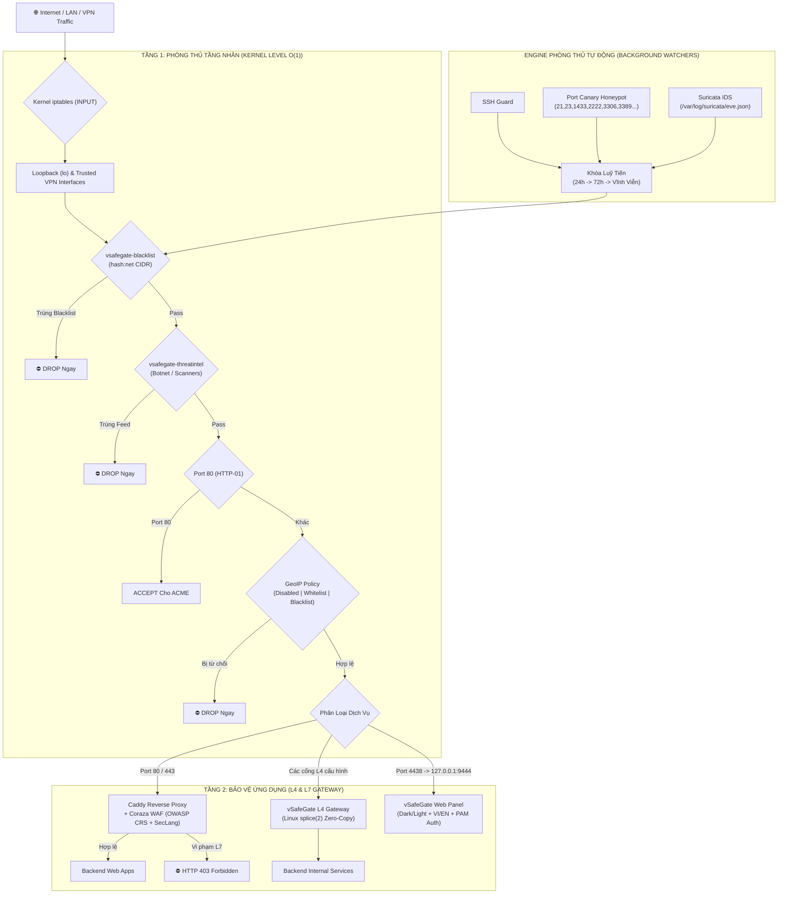

# 🛡️ vSafeGate — Hệ Thống Tường Lửa Web (WAF) & L4 Stream Gateway

> **Ngôn ngữ / Language:** 🇻🇳 **Tiếng Việt** ([README.md](README.vi.md)) | 🇬🇧 [English](README.md)

> **Open-Source Web Application Firewall (WAF) & L4 Stream Gateway**  
> Giải pháp tường lửa đa máy chủ viết bằng Go: Bảo vệ 2 tầng (Linux Kernel `iptables`/`ipset` + Coraza WAF / L4 Zero-Copy `splice(2)`), giao diện Web **Dark/Light Theme**, **Đa ngôn ngữ (Tiếng Việt / English)** và nhúng hoàn toàn tài nguyên trong **1 file binary duy nhất** (0 CDN, 0 Docker bắt buộc).

---

## 🚀 ĐIỂM NỔI BẬT

- **Bảo Vệ 2 Tầng Chuyên Sâu (2-Tier Defense):**
  - **Tầng 1 (Kernel Level - O(1)):** Lọc kết nối ngay tại nhân Linux bằng `iptables` + `ipset` (`vsafegate-blacklist`, `vsafegate-threatintel`, `vsafegate-allowed`, `vsafegate-countries`).
  - **Tầng 2 (Application Level - L7 WAF):** Tích hợp **Caddy + Coraza WAF** kèm chuẩn **OWASP Core Rule Set (CRS)** và quy tắc tùy biến SecLang (`/etc/caddy/rules/custom-rules.conf`).
- **Kiến Trúc Đa Máy Chủ (Multi-Server Ready & Zero Hardcode):**
  - **GeoIP 3 Chế Độ (`disabled` | `whitelist` | `blacklist`):** Mặc định là `disabled` khi cài mới để tránh tự khóa quản trị viên trên VPS quốc tế; hỗ trợ chọn bật Whitelist hoặc Blacklist theo quốc gia bất kỳ lúc nào.
  - **Tự Động Phát Hiện Card Mạng (Auto-Detect Interfaces):** Tự quét LAN, Tailscale, WireGuard, ZeroTier, Docker/Bridge để đề xuất CIDR đưa vào Whitelist chỉ bằng 1 cú nhấp chuột.
  - **Anti-Lockout Fail-Safe:** Script cài đặt `install.sh` tự động phát hiện IP SSH hiện tại (`$SSH_CLIENT` / `$SSH_CONNECTION`) và thêm vào `whitelist_ips` ngay từ đầu.
- **L4 Stream Gateway Hiệu Năng Cao (Zero-Copy Linux `splice`):**
  - Chuyển tiếp TCP trực tiếp bằng system call `splice(2)` ở tầng Kernel (giảm copy user-space) cho các dịch vụ như SMB (`445`), SSH, RDP, Database hoặc Web nội bộ.
- **Giao Diện Quản Trị Hiện Đại (Enterprise Web Dashboard):**
  - **Dark / Light Theme:** Chuyển đổi mượt mà giữa nền Tối và nền Sáng (tự đồng bộ màu biểu đồ Chart.js, lưu vào `localStorage`).
  - **Đa Ngôn Ngữ (i18n VI / EN):** Đổi nhanh giữa Tiếng Việt và English trực tiếp trên thanh Header (`mgt/web/i18n.js`).
  - **100% Tài Nguyên Nhúng (Zero-CDN):** Tailwind CSS, Chart.js, Lucide Icons và i18n được nhúng trực tiếp vào Go binary qua `//go:embed web/*`.
- **Phòng Thủ Chủ Động & Khóa Luỹ Tiến (Active Defense & Escalation Ban):**
  - **SSH Guard:** Giám sát nhật ký đăng nhập SSH sai (mặc định 3 lần -> auto-ban).
  - **Port Canary Honeypot:** Lắng nghe trên các cổng bẫy (`21, 23, 1433, 2222, 3306, 3389, 5060, 5432, 6379, 8088`) để bắt và khóa bot dò quét cổng.
  - **Suricata IDS Integration:** Theo dõi `/var/log/suricata/eve.json` và tự động chặn IP vi phạm mức nghiêm trọng 1.
  - **Chính sách khóa luỹ tiến:** Vi phạm lần 1 khóa **24h** (theo `default_ban_ttl_hours`), lần 2 khóa **72h**, lần 3+ khóa **Vĩnh viễn**.
- **Nhật Ký Tấn Công Bền Vững (Persistent JSONL):** Ghi vào `/var/log/vsafegate/attacks.jsonl` có xoay vòng tự động (Log Rotation 20MB).

---

## 📦 HƯỚNG DẪN CÀI ĐẶT & CHẠY SCRIPT (TỪNG BƯỚC)

### Yêu Cầu Hệ Thống
- **Hệ điều hành Linux:** Debian, Ubuntu, Proxmox VE (`systemd`), Alpine Linux (`OpenRC`), RHEL/CentOS/Rocky/Alma (`systemd`), hoặc Arch Linux.
- **Kiến trúc CPU:** `x86_64` (`amd64`) hoặc `aarch64` (`arm64`).
- **Quyền thực thi:** `root` hoặc `sudo`.
- **Gói phụ thuộc (script tự cài):** `curl`, `ipset`, `iptables`, `ca-certificates`, `tar`, `python3` (+ `bash` trên Alpine).
- **Caddy + Coraza WAF (Tùy chọn cho L7 WAF & HTTPS `:4438`):** Daemon quản trị `vsafegate` lắng nghe nội bộ tại `127.0.0.1:9444`. Để bật Reverse Proxy HTTPS `:4438` và L7 WAF `:80`/`:443`, máy chủ cần có Caddy biên dịch kèm plugin `coraza-caddy/v2` (xem **Bước 4** bên dưới).

---

### Cách 1: Cài Đặt Nhanh Bằng 1 Lệnh Từ GitHub (Khuyến Nghị)

> Áp dụng khi kho GitHub đã có bản phát hành (Release) hoặc bạn muốn tự động cài đặt toàn bộ môi trường & dịch vụ hệ thống.

**Bước 1:** Đăng nhập SSH vào máy chủ Linux với quyền `root` hoặc tài khoản có `sudo`.

**Bước 2:** Chạy lệnh cài đặt tự động:
```bash
curl -fsSL https://raw.githubusercontent.com/daovantrong/vSafeGate/main/install.sh | sudo bash
```

**Script `install.sh` sẽ tự động thực hiện:**
1. Kiểm tra quyền `root`, nhận diện kiến trúc (`amd64` / `arm64`), hệ điều hành (`debian` / `alpine` / `rhel` / `arch`) và trình quản lý dịch vụ (`systemd` / `openrc`).
2. Cài đặt các gói hệ thống cần thiết (`curl`, `ipset`, `iptables`, `ca-certificates`, `tar`, `python3`).
3. **Chống tự khóa SSH:** Tự đọc IP từ `$SSH_CLIENT` / `$SSH_CONNECTION` và nạp trước vào danh sách `whitelist_ips`.
4. Tải binary mới nhất từ [GitHub Releases](https://github.com/daovantrong/vSafeGate/releases) vào `/usr/local/bin/vsafegate` (nếu chưa có Release trên GitHub, script sẽ tự tìm binary cục bộ hoặc biên dịch từ `./mgt` nếu máy có Go).
5. Khởi tạo `/etc/vsafegate/config.json` với trạng thái an toàn (`"geoip_mode": "disabled"`).
6. Tạo và khởi động service hệ thống (`vsafegate.service` cho `systemd` hoặc `/etc/init.d/vsafegate` cho `OpenRC`) cùng symlink `/usr/bin/vsafegate`.

---

### Cách 2: Clone GitHub, Tự Biên Dịch & Chạy Script Cục Bộ

Phù hợp khi bạn muốn tự build trực tiếp từ mã nguồn Go (yêu cầu **Go 1.22+**) hoặc khi repo chưa tạo GitHub Release:

```bash
# Bước 1: Tải mã nguồn từ GitHub
git clone https://github.com/daovantrong/vSafeGate.git
cd vSafeGate

# Bước 2: Chạy Unit Test & Biên dịch binary cho máy chủ Linux hiện tại
cd mgt
go test -v ./...
CGO_ENABLED=0 go build -ldflags="-s -w" -o ../vsafegate-linux-$(uname -m | sed 's/x86_64/amd64/;s/aarch64/arm64/') .
cd ..

# Bước 3: Cấp quyền thực thi và chạy script cài đặt
chmod +x install.sh
sudo bash install.sh
```

> **Cross-compile từ Windows / macOS sang Linux:**
> ```powershell
> cd mgt
> $env:CGO_ENABLED="0"; $env:GOOS="linux"; $env:GOARCH="amd64"
> go build -ldflags="-s -w" -o ../vsafegate-linux-amd64 .
> ```
> Sau đó chép file `vsafegate-linux-amd64` và `install.sh` lên máy chủ Linux rồi chạy `sudo bash install.sh`.

---

### Bước 3: Cài Đặt Caddy + Coraza WAF (Cho L7 WAF & HTTPS `:4438`)

`vsafegate` tự động sinh cấu hình `/etc/caddy/Caddyfile` và `/etc/caddy/rules/custom-rules.conf`, sau đó gọi reload `caddy`. Bạn có 2 lựa chọn triển khai Caddy:

- **Lựa chọn A — Build native binary bằng `xcaddy` (Khuyến nghị trên host trực tiếp):**
  ```bash
  go install github.com/caddyserver/xcaddy/cmd/xcaddy@latest
  xcaddy build --with github.com/corazawaf/coraza-caddy/v2 --output /usr/bin/caddy
  chmod +x /usr/bin/caddy
  ```
- **Lựa chọn B — Chạy Caddy + Coraza qua Docker Compose có sẵn trong repo:**
  ```bash
  docker compose up -d --build
  ```

> **Lưu ý nếu chưa cài Caddy:** Daemon `vsafegate` vẫn chạy độc lập trên `127.0.0.1:9444` (để bảo vệ L4 Gateway, iptables/ipset, SSH Guard, Canary). Bạn có thể mở giao diện Web an toàn qua SSH Tunnel từ máy cá nhân:
> ```bash
> ssh -L 9444:127.0.0.1:9444 <user>@<SERVER_IP>
> # Sau đó mở trình duyệt tại: http://127.0.0.1:9444/
> ```

---

### Bước 4: Truy Cập & Cấu Hình Lần Đầu Trên Web Dashboard

1. Mở trình duyệt truy cập:
   - Qua Caddy HTTPS: `https://<SERVER_IP>:4438/` (chấp nhận chứng chỉ nội bộ `tls internal` lần đầu)
   - Hoặc qua SSH Tunnel: `http://127.0.0.1:9444/`
2. Đăng nhập bằng **tài khoản Linux (PAM / `/etc/shadow`)** của máy chủ (hoặc cấu hình `admin_user` / `admin_password` trong `/etc/vsafegate/config.json`).
3. Trên thanh Header góc trên bên phải:
   - Nhấn nút **`🇻🇳 VI` / `🇬🇧 EN`** để chuyển ngôn ngữ.
   - Nhấn nút **☀️ / 🌙** để chuyển **Light / Dark Theme**.
4. Vào tab **Quy Tắc Phòng Thủ (Defense Rules)** hoặc **Giám Sát IP (IP Management)**:
   - Nhấn **`Rule Mẫu Card Mạng`** (Auto-Detect) để nạp nhanh dải mạng LAN/VPN thực tế của máy chủ.
   - Nếu cần giới hạn quốc gia, chuyển chế độ GeoIP sang **`Whitelist`** hoặc **`Blacklist`** và chọn quốc gia tương ứng.
5. Vào tab **Website & Proxy** / **Dịch Vụ L4** để thêm các dịch vụ cần bảo vệ.

---

### Cách 3: Chạy Chế Độ Phát Triển (Development Mode)

Dùng để thử nghiệm giao diện và API ngay trên máy cá nhân (Windows/Linux/macOS):

```bash
cd mgt
ENV=dev go run .
```
- Đọc/ghi dữ liệu cục bộ tại `./config.json`, `./Caddyfile`, `./rules/custom-rules.conf`, `./attacks.jsonl`.
- Cho phép đăng nhập nhanh bằng tài khoản dev `admin` / `vsafegate123` (chỉ hoạt động khi `ENV=dev`).

---

## 📐 KIẾN TRÚC HỆ THỐNG



---

## 🤖 PHÁT HÀNH TỰ ĐỘNG QUA GITHUB ACTIONS (CI/CD)

Kho mã nguồn đã tích hợp workflow [`.github/workflows/release.yml`](.github/workflows/release.yml). Khi bạn đẩy một Git tag mới (ví dụ `v2.1.0`), GitHub Actions sẽ tự động:
1. Chạy toàn bộ unit test (`cd mgt && go test -v ./...`).
2. Biên dịch chéo binary không phụ thuộc (`CGO_ENABLED=0`) cho **`linux/amd64`** và **`linux/arm64`**.
3. Tạo file kiểm tra toàn vẹn `sha256sums.txt`.
4. Tạo **GitHub Release** mới đính kèm `vsafegate-linux-amd64`, `vsafegate-linux-arm64`, `sha256sums.txt` và `install.sh` — giúp người dùng chạy được ngay lệnh `curl ... install.sh | sudo bash`.

```bash
git tag v2.1.0
git push origin v2.1.0
```

---

## 📁 CẤU TRÚC THƯ MỤC DỰ ÁN

```text
vSafeGate/
├── .github/workflows/
│   └── release.yml             # CI/CD tự động test, build amd64/arm64 và tạo GitHub Release
├── install.sh                  # Script cài đặt vạn năng 1 dòng (Systemd & OpenRC)
├── README.md                   # Tài liệu hướng dẫn Tiếng Việt
├── README.en.md                # Tài liệu hướng dẫn Tiếng Anh
├── SERVERS.md                  # Tài liệu mẫu danh mục máy chủ & ánh xạ cổng
├── Dockerfile                  # Build Caddy 2.8 kèm Coraza WAF plugin
├── docker-compose.yml          # Triển khai Caddy + Coraza container
├── Caddyfile                   # Mẫu Caddyfile khởi tạo cho Docker
├── rules/
│   └── custom-rules.conf       # Quy tắc WAF Coraza SecLang tùy biến
└── mgt/                        # Mã nguồn Go của vSafeGate Management Daemon
    ├── main.go                 # HTTP API, khởi tạo mặc định an toàn & nhúng giao diện Web
    ├── models.go               # Cấu trúc dữ liệu Config, AttackLog, L4/L7, Presets
    ├── auth.go                 # Xác thực PAM/Shadow (`/usr/local/bin/vsafegate-auth`) & PBKDF-SHA256
    ├── blacklist.go            # Quản lý Blacklist, TTL Auto-Unban & Khóa luỹ tiến
    ├── caddy.go                # Tự động sinh Caddyfile & Custom Rules (Debounced Reload)
    ├── firewall.go             # Đồng bộ iptables & ipset (Disabled / Whitelist / Blacklist)
    ├── l4proxy.go              # L4 TCP Gateway tối ưu hóa bằng Linux splice(2)
    ├── log_manager.go          # Nhật ký attacks.jsonl bền vững kèm Log Rotation (20MB)
    ├── network_detector.go     # Tự động phát hiện card mạng LAN / VPN trên máy chủ
    ├── watchers.go             # SSH Guard, Port Canary Honeypot & Suricata EVE Watcher
    ├── *_test.go               # Bộ Unit Tests kiểm tra deadlock, blacklist, log, network detector
    └── web/                    # Tài nguyên Web nhúng trực tiếp vào binary
        ├── index.html          # Giao diện Dashboard (Dark / Light Theme)
        ├── i18n.js             # Bộ từ điển & engine đa ngôn ngữ (VI / EN)
        ├── tailwind.min.css    # Tailwind CSS biên dịch sẵn (0 CDN)
        ├── chart.min.js        # Chart.js cục bộ
        └── lucide.min.js       # Lucide Icons cục bộ
```

---

## 🛠️ VẬN HÀNH & KIỂM TRA HỆ THỐNG

### 1. Quản Lý Dịch Vụ
- **Debian / Ubuntu / Proxmox / RHEL / Arch (`systemd`):**
  ```bash
  sudo systemctl status vsafegate
  sudo systemctl restart vsafegate
  sudo journalctl -u vsafegate -f
  ```
- **Alpine Linux (`OpenRC`):**
  ```bash
  sudo rc-service vsafegate status
  sudo rc-service vsafegate restart
  ```

### 2. Kiểm Tra Tường Lửa Kernel (`ipset` & `iptables`)
```bash
# Xem danh sách IP/CIDR trong Allowlist & Blacklist
sudo ipset list vsafegate-allowed | head -n 20
sudo ipset list vsafegate-blacklist

# Xem thứ tự các rule iptables INPUT
sudo iptables -L INPUT -n --line-numbers
```

### 3. Kiểm Thử Phòng Thủ WAF & L4 Gateway
```bash
# Test 1: Kiểm tra WAF chặn SQL Injection (Kỳ vọng HTTP 403 Forbidden nếu đã cấu hình Site & Caddy)
curl -k -i -H "Host: app.example.com" "https://<GATEWAY_IP>/?id=1%20UNION%20SELECT%20null,null"

# Test 2: Kiểm tra WAF chặn Security Scanner UA
curl -k -i -A "sqlmap/1.8" -H "Host: app.example.com" "https://<GATEWAY_IP>/"

# Test 3: Kiểm tra cổng L4 Gateway đã khai báo
nc -zv <GATEWAY_IP> <L4_PORT>
```
