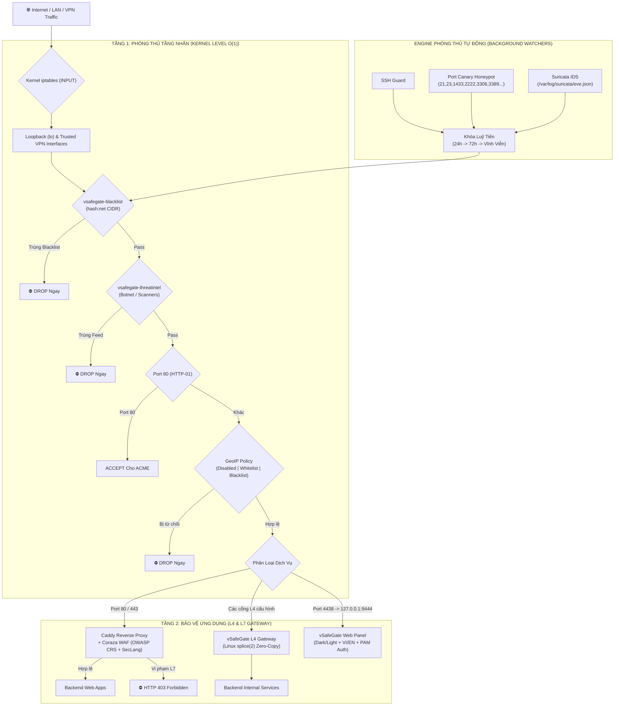

# 🛡️ vSafeGate — Hệ Thống Tường Lửa Web (WAF) & L4 Stream Gateway

> **Ngôn ngữ / Language:** 🇻🇳 **Tiếng Việt** ([README.vi.md](README.vi.md)) | 🇬🇧 [English](README.md)

> **Open-Source Web Application Firewall (WAF) & L4 Stream Gateway**  
> Giải pháp tường lửa đa máy chủ viết bằng Go: Bảo vệ 2 tầng (Linux Kernel `iptables`/`ipset` + Coraza WAF / L4 Zero-Copy `splice(2)`), giao diện Web **Dark/Light Theme**, **Đa ngôn ngữ (Tiếng Việt / English)** và nhúng hoàn toàn tài nguyên trong **1 file binary duy nhất** (0 CDN, 0 Docker bắt buộc).

---

## 🚀 ĐIỂM NỔI BẬT

- **Bảo Vệ 2 Tầng Chuyên Sâu (2-Tier Defense):**
  - **Tầng 1 (Kernel Level - O(1)):** Lọc kết nối ngay tại nhân Linux bằng `iptables` + `ipset` (`vsafegate-blacklist`, `vsafegate-threatintel`, `vsafegate-allowed`, `vsafegate-countries`).
  - **Tầng 2 (Application Level - L7 WAF):** Tích hợp **Caddy + Coraza WAF** kèm chuẩn **OWASP Core Rule Set (CRS)** và quy tắc tùy biến SecLang (`/etc/caddy/rules/custom-rules.conf`).
- **Kiến Trúc Đa Máy Chủ (Multi-Server Ready & Zero Hardcode):**
  - **GeoIP 3 Chế Độ (`disabled` | `whitelist` | `blacklist`):** Mặc định là `disabled` khi cài mới để tránh tự khóa quản trị viên trên VPS quốc tế; hỗ trợ chọn bật Whitelist hoặc Blacklist theo quốc gia bất kỳ lúc nào.
  - **Tự Động Phát Hiện Card Mạng (Auto-Detect Interfaces):** Tự quét LAN, Tailscale, WireGuard, ZeroTier, Docker/Bridge để đề xuất CIDR đưa vào Whitelist chỉ bằng 1 cú nhấp chuột.
  - **Anti-Lockout Fail-Safe:** Script cài đặt `install.sh` tự động phát hiện IP SSH hiện tại (`$SSH_CLIENT` / `$SSH_CONNECTION`) và thêm vào `whitelist_ips` ngay từ đầu.
- **L4 Stream Gateway Hiệu Năng Cao (Zero-Copy Linux `splice`):**
  - Chuyển tiếp TCP trực tiếp bằng system call `splice(2)` ở tầng Kernel (giảm copy user-space) cho các dịch vụ như SMB (`445`), SSH, RDP, Database hoặc Web nội bộ.
- **Giao Diện Quản Trị Hiện Đại (Enterprise Web Dashboard):**
  - **Dark / Light Theme:** Chuyển đổi mượt mà giữa nền Tối và nền Sáng (tự đồng bộ màu biểu đồ Chart.js, lưu vào `localStorage`).
  - **Đa Ngôn Ngữ (i18n VI / EN):** Đổi nhanh giữa Tiếng Việt và English trực tiếp trên thanh Header (`mgt/web/i18n.js`).
  - **100% Tài Nguyên Nhúng (Zero-CDN):** Tailwind CSS, Chart.js, Lucide Icons và i18n được nhúng trực tiếp vào Go binary qua `//go:embed web/*`.
- **Phòng Thủ Chủ Động & Khóa Luỹ Tiến (Active Defense & Escalation Ban):**
  - **SSH Guard:** Giám sát nhật ký đăng nhập SSH sai (mặc định 3 lần -> auto-ban).
  - **Port Canary Honeypot:** Lắng nghe trên các cổng bẫy (`21, 23, 1433, 2222, 3306, 3389, 5060, 5432, 6379, 8088`) để bắt và khóa bot dò quét cổng.
  - **Suricata IDS Integration:** Theo dõi `/var/log/suricata/eve.json` và tự động chặn IP vi phạm mức nghiêm trọng 1.
  - **Chính sách khóa luỹ tiến:** Vi phạm lần 1 khóa **24h** (theo `default_ban_ttl_hours`), lần 2 khóa **72h**, lần 3+ khóa **Vĩnh viễn**.
- **Nhật Ký Tấn Công Bền Vững (Persistent JSONL):** Ghi vào `/var/log/vsafegate/attacks.jsonl` có xoay vòng tự động (Log Rotation 20MB).

---

## 📦 CÀI ĐẶT TỰ ĐỘNG HOÀN TOÀN (1 LỆNH DUY NHẤT)

### Yêu Cầu Hệ Thống
- **Hệ điều hành Linux:** Debian, Ubuntu, Proxmox VE (`systemd`), Alpine Linux (`OpenRC`), RHEL/CentOS/Rocky/Alma (`systemd`), hoặc Arch Linux.
- **Kiến trúc CPU:** `x86_64` (`amd64`) hoặc `aarch64` (`arm64`).
- **Quyền thực thi:** `root` hoặc `sudo`.

---

### Cài Đặt Toàn Bộ Hệ Thống Trong 1 Lệnh

Chỉ cần SSH vào máy chủ và chạy duy nhất lệnh sau — **script sẽ tự động tải, biên dịch (nếu cần), cài đặt và khởi chạy toàn bộ từ A-Z mà không bắt bạn cài thủ công Go hay Caddy**:

```bash
curl -fsSL https://raw.githubusercontent.com/daovantrong/vSafeGate/main/install.sh | sudo bash
```

**Script `install.sh` tự động làm hết 100%:**
1. **Nhận diện hệ thống:** Tự phát hiện kiến trúc (`amd64` / `arm64`), distro Linux (`debian`, `alpine`, `rhel`, `arch`) và init system (`systemd` hoặc `OpenRC`).
2. **Cài đặt gói hệ thống:** Tự cài `iptables`, `ipset`, `curl`, `git`, `python3`, `ca-certificates`, `tar`, `gzip`.
3. **Chống tự khóa SSH (Anti-Lockout):** Tự đọc IP phiên SSH hiện tại (`$SSH_CLIENT` / `$SSH_CONNECTION`) và nạp sẵn vào `whitelist_ips`.
4. **Cài đặt Core `vsafegate`:** Tự tải binary từ [GitHub Releases](https://github.com/daovantrong/vSafeGate/releases); nếu chưa có bản phát hành, **tự động tải Go tạm thời, clone mã nguồn, biên dịch `/usr/local/bin/vsafegate` và xóa sạch file tạm**.
5. **Cài đặt `Caddy + Coraza WAF`:** Tự tải Caddy tích hợp sẵn `coraza-caddy/v2` (hoặc **tự động biên dịch qua `xcaddy`**) vào `/usr/bin/caddy`, chạy ngay L7 WAF (`:80`/`:443`) và HTTPS Dashboard (`:4438`).
6. **Cấu hình an toàn đa server:** Tạo `/etc/vsafegate/config.json` với `"geoip_mode": "disabled"` (không tự khóa VPS ở nước ngoài).
7. **Kích hoạt Threat Intelligence tự động:** Cài `/usr/local/bin/vsafegate-sync-threatintel.sh`, lập lịch cron hằng ngày và đồng bộ ngay bảng chặn `vsafegate-threatintel`.
8. **Đăng ký & Khởi chạy dịch vụ:** Tạo và bật đồng thời service `vsafegate` + `caddy`, kèm lệnh cập nhật nhanh `sudo vsafegate-update`.

---

### Truy Cập & Cấu Hình Sau Khi Cài Đặt

1. Mở trình duyệt truy cập URL hiển thị ở cuối quá trình cài đặt:
   - **`https://<SERVER_IP>:4438/`** *(chấp nhận chứng chỉ tự ký nội bộ ở lần đầu)*
2. Đăng nhập bằng **tài khoản Linux (`sudo` user)** của máy chủ.
3. Trên góc phải thanh Header:
   - Nhấn **`🇻🇳 VI` / `🇬🇧 EN`** để chuyển ngôn ngữ.
   - Nhấn **☀️ / 🌙** để đổi **Light / Dark Theme**.
4. Vào **Quy Tắc Phòng Thủ (Defense Rules)** → nhấn **`Rule Mẫu Card Mạng`** để tự quét & cho phép các card mạng LAN/VPN (Tailscale, WireGuard, Ethernet...), sau đó cấu hình GeoIP hoặc dịch vụ L4/L7 theo nhu cầu.

### Cập Nhật Phiên Bản Mới Trong 1 Lệnh
```bash
sudo vsafegate-update
```
*(Tự động tải/build bản mới nhất và khởi động lại `vsafegate` & `caddy` mà vẫn **giữ nguyên** toàn bộ cấu hình trong `/etc/vsafegate/config.json`)*

---

### Tùy Chọn Nâng Cao (Developer / Docker)

<details>
<summary>Mở rộng để xem cách chạy từ repo đã clone, chế độ Dev hoặc Docker Compose</summary>

#### A. Chạy script từ thư mục repo đã clone sẵn
```bash
git clone https://github.com/daovantrong/vSafeGate.git
cd vSafeGate
sudo bash install.sh
```

#### B. Chạy thử nghiệm giao diện cục bộ (Development Mode)
```bash
cd mgt
ENV=dev go run .
```
- Sử dụng dữ liệu cục bộ `./config.json`, `./Caddyfile`, `./rules/custom-rules.conf`, `./attacks.jsonl`.
- Tài khoản dev: `admin` / `vsafegate123` (chỉ hoạt động khi `ENV=dev`).

#### C. Chạy riêng Caddy + Coraza bằng Docker Compose
```bash
docker compose up -d --build
```

</details>

---

## 📐 KIẾN TRÚC HỆ THỐNG



---

## 🤖 PHÁT HÀNH TỰ ĐỘNG QUA GITHUB ACTIONS (CI/CD — KHÉP KÍN TRONG REPO)

Toàn bộ mã nguồn và phụ thuộc của Caddy + Coraza WAF + OWASP CRS đã được lưu (vendored) trọn vẹn trong [`caddy-core/`](caddy-core/) (`Caddy v2.11.9`, `coraza-caddy/v2 v2.6.2`, `coraza-coreruleset/v4 v4.25.0`, biên dịch bằng `Go 1.27.1`) và [`mgt/`](mgt/) không dùng bất kỳ thư viện Go ngoài nào — đảm bảo build không bao giờ bị gãy khi bên ngoài thay đổi.

Khi bạn đẩy tag phát hành (ví dụ `v1.0.1`), workflow [`.github/workflows/release.yml`](.github/workflows/release.yml) sẽ tự động:
1. Chạy toàn bộ unit test (`cd mgt && go test -v ./...`).
2. Biên dịch chéo binary tĩnh (`CGO_ENABLED=0`, `-mod=vendor`) cho **`linux/amd64`** và **`linux/arm64`**, gồm cả **`vsafegate`** và **`caddy-coraza`**.
3. Tạo file kiểm tra toàn vẹn `sha256sums.txt`.
4. Tạo **GitHub Release** mới đính kèm `vsafegate-linux-amd64`, `vsafegate-linux-arm64`, `caddy-coraza-linux-amd64`, `caddy-coraza-linux-arm64`, `sha256sums.txt`, `VERSION` và `install.sh`.

```bash
git tag v1.0.1
git push origin v1.0.1
```

---

## 📁 CẤU TRÚC THƯ MỤC DỰ ÁN

```text
vSafeGate/
├── .github/workflows/
│   └── release.yml             # CI/CD tự động test, build amd64/arm64 (Go 1.27.1, vendored) & Release
├── VERSION                     # Phiên bản phát hành chuẩn (1.0.1)
├── install.sh                  # Script cài đặt tự động hoàn toàn 1 dòng (Systemd & OpenRC)
├── README.md                   # Tài liệu hướng dẫn Tiếng Anh (Mặc định)
├── README.vi.md                # Tài liệu hướng dẫn Tiếng Việt
├── SERVERS.md                  # Tài liệu mẫu danh mục máy chủ & ánh xạ cổng
├── Dockerfile                  # Docker build offline từ caddy-core (golang:1.27.1-alpine -> alpine:3.21)
├── docker-compose.yml          # Triển khai Caddy + Coraza container
├── Caddyfile                   # Mẫu Caddyfile khởi tạo cho Docker
├── rules/
│   └── custom-rules.conf       # Quy tắc WAF Coraza SecLang tùy biến
├── scripts/
│   └── vsafegate-sync-threatintel.sh  # Script đồng bộ Threat Intelligence ipset
├── caddy-core/                 # Mã nguồn + toàn bộ dependency đã vendor của Caddy & Coraza WAF
│   ├── main.go                 # Entrypoint đăng ký module Caddy chuẩn + Coraza WAF
│   ├── go.mod / go.sum         # Khóa cứng Go 1.27.1, Caddy v2.11.9, Coraza-Caddy v2.6.2
│   └── vendor/                 # Toàn bộ thư viện Go đi kèm (build offline 100%, không lo upstream đổi)
└── mgt/                        # Mã nguồn Go của vSafeGate Management Daemon (chỉ dùng thư viện chuẩn)
    ├── main.go                 # HTTP API, khởi tạo mặc định an toàn & nhúng giao diện Web
    ├── models.go               # Cấu trúc dữ liệu Config, AttackLog, L4/L7, Presets
    ├── auth.go                 # Xác thực PAM/Shadow (`/usr/local/bin/vsafegate-auth`) & PBKDF-SHA256
    ├── blacklist.go            # Quản lý Blacklist, TTL Auto-Unban & Khóa luỹ tiến
    ├── caddy.go                # Tự động sinh Caddyfile & Custom Rules (Debounced Reload)
    ├── firewall.go             # Đồng bộ iptables & ipset (Disabled / Whitelist / Blacklist)
    ├── l4proxy.go              # L4 TCP Gateway tối ưu hóa bằng Linux splice(2)
    ├── log_manager.go          # Nhật ký attacks.jsonl bền vững kèm Log Rotation (20MB)
    ├── network_detector.go     # Tự động phát hiện card mạng LAN / VPN trên máy chủ
    ├── watchers.go             # SSH Guard, Port Canary Honeypot & Suricata EVE Watcher
    ├── *_test.go               # Bộ Unit Tests kiểm tra deadlock, blacklist, log, network detector
    └── web/                    # Tài nguyên Web nhúng trực tiếp vào binary
        ├── index.html          # Giao diện Dashboard (Dark / Light Theme)
        ├── i18n.js             # Bộ từ điển & engine đa ngôn ngữ (VI / EN)
        ├── tailwind.min.css    # Tailwind CSS biên dịch sẵn (0 CDN)
        ├── chart.min.js        # Chart.js cục bộ
        └── lucide.min.js       # Lucide Icons cục bộ
```

---

## 🛠️ VẬN HÀNH & KIỂM TRA HỆ THỐNG

### 1. Quản Lý Dịch Vụ
- **Debian / Ubuntu / Proxmox / RHEL / Arch (`systemd`):**
  ```bash
  sudo systemctl status vsafegate caddy
  sudo systemctl restart vsafegate caddy
  sudo journalctl -u vsafegate -f
  ```
- **Alpine Linux (`OpenRC`):**
  ```bash
  sudo rc-service vsafegate status && sudo rc-service caddy status
  sudo rc-service vsafegate restart && sudo rc-service caddy restart
  ```

### 2. Kiểm Tra Tường Lửa Kernel (`ipset` & `iptables`)
```bash
# Xem danh sách IP/CIDR trong Allowlist & Blacklist
sudo ipset list vsafegate-allowed | head -n 20
sudo ipset list vsafegate-blacklist

# Xem thứ tự các rule iptables INPUT
sudo iptables -L INPUT -n --line-numbers
```

### 3. Kiểm Thử Phòng Thủ WAF & L4 Gateway
```bash
# Test 1: Kiểm tra WAF chặn SQL Injection (Kỳ vọng HTTP 403 Forbidden nếu đã cấu hình Site & Caddy)
curl -k -i -H "Host: app.example.com" "https://<GATEWAY_IP>/?id=1%20UNION%20SELECT%20null,null"

# Test 2: Kiểm tra WAF chặn Security Scanner UA
curl -k -i -A "sqlmap/1.8" -H "Host: app.example.com" "https://<GATEWAY_IP>/"

# Test 3: Kiểm tra cổng L4 Gateway đã khai báo
nc -zv <GATEWAY_IP> <L4_PORT>
```
